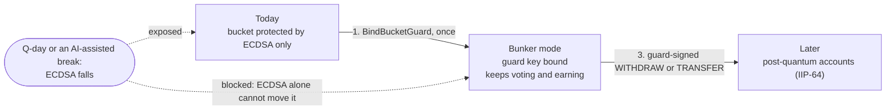
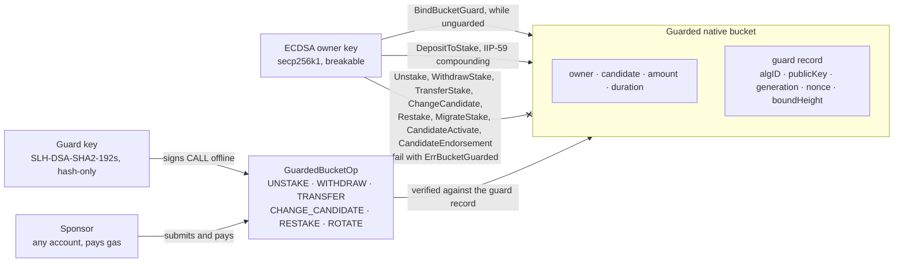
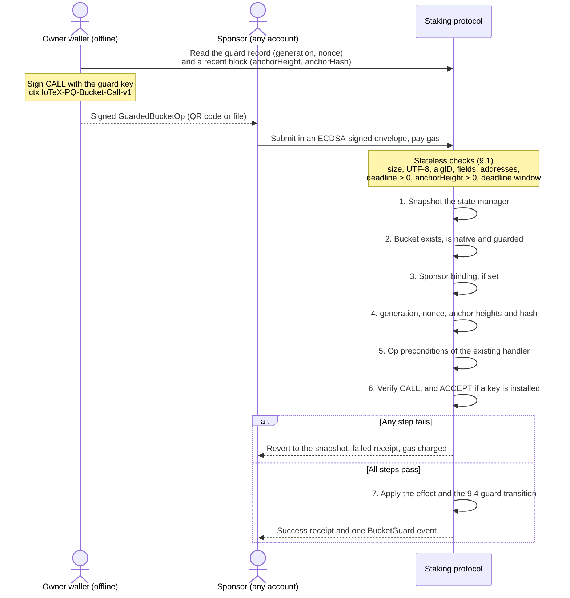
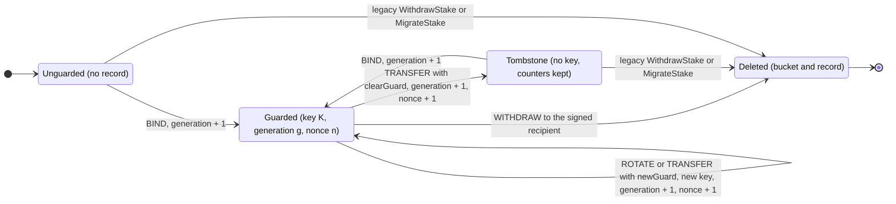

```
IIP: 65
Title: Bunker Mode: Quantum-Safe Staking Buckets
Author: Raullen Chai (@raullenchai), Chen Chen (@envestcc)
Discussions-to: https://github.com/iotexproject/iips/pull/87
Status: Draft
Type: Standards Track
Category: Core
Created: 2026-10-19
Revised: 2026-11-09 (Draft 4)
Requires: 59, 61, 64
```

## Simple Summary

A doomsday bunker for staked IOTX. Nobody knows when a quantum computer, or an
AI-assisted mathematical result, will break the ECDSA keys that protect IoTeX
accounts today. A post-quantum upgrade for ordinary accounts needs Ethereum,
exchanges, wallets, and hardware vendors to move together, and that will take
years. IoTeX does not have to wait for them to build a shelter.

This IIP lets any holder put a native staking bucket into **bunker mode** by
locking it with a second, hash-based key (SLH-DSA, NIST FIPS 205). Once a bucket
is locked, nothing that moves, re-owns, unstakes, or re-votes it is accepted
unless that key has signed it. An ECDSA signature alone is no longer enough,
so the bucket's principal, ownership, and votes stay protected even if the
owner's secp256k1 key is broken, within the scope and exclusions defined below.

### The bunker in three steps

1. **Go in now.** The owner binds a guard key to the bucket, once, while the
   ECDSA key is still safe. The bunker only protects what is inside when the
   storm hits, so earlier is better.
2. **Wait it out.** Inside, the bucket keeps voting and earning staking
   rewards. The door is heavy: a guard signature is about 16 KB and is made
   offline. That is acceptable because the door is rarely opened, a few times a
   year at most.
3. **Come out later.** When post-quantum accounts exist (IIP-64) and the
   ecosystem has caught up, the owner signs one guard operation to move the IOTX
   out.



*Figure 1. Go in early, wait it out, and come out with the guard key. "Bunker
mode" is the informal name for a guarded bucket; the specification below says
"guard".*

## Abstract

This IIP adds an opt-in **bucket guard** to native staking buckets. A guard is an
SLH-DSA-SHA2-192s public key plus replay counters, stored in a new staking-state
namespace. It introduces two new staking actions:

* `BindBucketGuard`, sent by the bucket owner, attaches a guard to a bucket.
* `GuardedBucketOp` performs one of a closed set of bucket operations, authorized
  only by the guard.

On a guarded bucket, the existing ECDSA-authorized bucket actions fail. Any
account may sponsor (submit and pay for) a `GuardedBucketOp`. Hash-based
signatures rely on well-studied properties of hash functions and avoid the
elliptic-curve and structured-lattice assumptions, so a guard is robust to a
break of either.

This IIP is a self-contained first deliverable of the IIP-64 migration. It needs
no EVM precompile, no new address format, no emergency mode, no account-level
key change, and no support from exchanges, hardware wallets, or other chains.

### Overview

A guard is an additional lock, not a new owner. The bucket keeps its ECDSA owner,
its votes, and its rewards. What changes is who may move it.



*Figure 2. Once a bucket is guarded, the ECDSA key can only add funds to it.
Every operation that moves, re-owns, unstakes, or re-votes the bucket needs a
signature from the guard key. Anyone can submit that signed operation.*

## Motivation

1. **A vault IoTeX can ship alone.** Post-quantum signatures for ordinary
   accounts (EOAs) depend on decisions that IoTeX does not control: which
   algorithms Ethereum adopts, and whether exchanges, wallets, and hardware
   vendors support them. A transaction format that nobody else signs gives
   users nothing. A staking bucket is different. Every component of a bucket
   guard is a published NIST standard (FIPS 205), signing happens offline in the
   user's wallet, and any account can submit the signed operation. IoTeX can
   therefore offer a safe place for IOTX now, and follow the industry on EOAs
   later.
2. **Time is what makes an opt-in vault work.** A cryptographically relevant
   quantum computer is not believed to be imminent, and Bitcoin and Ethereum
   have not settled their own migrations. That lead time is the opportunity: a
   guard protects only buckets bound before a break, so the vault has to be
   filled ahead of time. A break of a *structured* assumption may also come with
   no hardware warning (IIP-64 §1.5), for example from an AI-assisted classical
   result. Holders are therefore encouraged to bind early.

   ```mermaid
   timeline
       title What a guard protects, before and after an ECDSA break
       section Now
           QSB fork activates : Owners bind guards to their buckets
       section Lead time
           The vault fills : Guarded IOTX keeps staking and earning rewards
       section ECDSA break
           Guarded buckets : Principal and votes stay safe
           Unguarded buckets : An attacker withdraws them or binds its own guard first
       section Post-quantum accounts
           Exit : Holders move funds to post-quantum accounts under IIP-64
   ```

   *Figure 3. The vault only protects what is inside it when the break happens.*

3. **Low-frequency operations can afford conservative cryptography.** Owners
   act on a bucket a few times a year, unlike EOA or contract signatures that a
   DEX user may produce many times a day. Bucket operations can therefore use a
   slow-to-sign, small-signature, hash-only scheme at a high security category.
   The on-chain costs that matter are verification time and action size, and
   both must stay far below the per-block budgets (§8).
4. **Votes are consensus.** Delegates are elected by bucket votes. Someone who
   can forge an owner's ECDSA signature can redirect votes with
   `ChangeCandidate`. Guarding that operation removes a path to capturing
   consensus.
5. **The vault also covers loss of the everyday key.** If an owner loses their
   ECDSA key, the guard alone can withdraw the bucket to a new address or
   transfer it to a new owner, with any account paying the gas.

## Specification

The key words MUST, MUST NOT, SHOULD, and MAY are to be interpreted as in RFC 2119.

### 1. Activation and dependencies

All rules take effect at the height of a future hard fork (`QSBHeight`, set by
governance). Before that height, both new actions are invalid. Activation MUST
NOT precede Zanzibar Gamma, because this IIP relies on the
`RevertStakingStateOnFailedReceipt` behavior (§9).

### 2. Algorithms

Algorithm identifiers are those of the canonical table in IIP-64 §4.1.3, which
is the single registry for post-quantum algorithm identifiers on IoTeX. This IIP
does not allocate identifiers. Identifier values are carried as `uint32` in the
messages and transcripts of this IIP.

The set accepted by this IIP is fixed by consensus and is identical on every
node:

| ID (IIP-64 §4.1.3) | Algorithm | NIST category | Public key | Signature | Interface | Standard |
|---|---|---|---|---|---|---|
| `0x12` | SLH-DSA-SHA2-192s | 3 | 48 bytes | 16,224 bytes | Pure, external (`slh_sign` / `slh_verify`) | FIPS 205 final, 2024-08-13 |

This table is normative for this IIP on its own. Consensus under `ParamsV1`
does not depend on later edits of the IIP-64 registry; changing any entry
requires a new parameter version (§8).

* Any other algorithm ID MUST be rejected. Accepting another identifier from
  the IIP-64 table requires a future fork and a new parameter version (§8).
* Signatures use the FIPS 205 **external, pure** interface (`slh_sign` /
  `slh_verify`) with the context strings of §7. Pre-hash (HashSLH-DSA) MUST NOT
  be used.
* Implementations MUST select the parameter set from the algorithm ID, never
  from the key or signature bytes.
* Implementations MUST conform to FIPS 205 as published (August 2024), not to
  the SPHINCS+ round-3 submission. In particular, for category 3 the SHA2
  instantiation uses SHA-512 for `H_msg`, `PRF_msg`, `H`, and `T`, and SHA-256
  for `F` and `PRF` (FIPS 205 §11.2.2). Conformance MUST be demonstrated with
  NIST ACVP vectors.

When this IIP activates, the IIP-64 §4.1.3 role column for `0x12` SHOULD list
"bucket guard (this IIP)".

### 3. Scope: which buckets can be guarded

A bucket MAY be guarded only if all of the following hold:

* (a) It is a native bucket (`ContractAddress` is empty). Contract-staking buckets
  are out of scope.
* (b) It is not the self-stake bucket of any candidate.
* (c) It has no endorsement record in any state, including an unendorse-requested
  endorsement.

While a bucket is guarded, the protocol MUST keep (b) and (c) true. A guarded
bucket MUST NOT become a self-stake bucket through `CandidateActivate`, and MUST
NOT receive an endorsement record through `CandidateEndorsement`. Both fail with
`ErrBucketGuarded`. `CandidateRegister` either creates a fresh, initially
unguarded bucket or (zero-stake registration) none, so it is unaffected.

Conditions (b) and (c) are **structural**:

* (b) means no candidate's `SelfStakeBucketIdx` equals the bucket index,
  regardless of unstake or exit status.
* (c) means an endorsement-state `Get` for the bucket returns
  `ErrStateNotExist`.

Implementations MUST NOT substitute `isSelfStakeBucket` or the endorsement
`Status`. Both can report false or none for records that are still referenced or
have expired.

An endorsement record is deleted only by an explicit `CandidateEndorsement`
revoke; it does not disappear when it expires. A bucket that was ever endorsed
and not revoked is therefore out of scope under (c). Wallets SHOULD detect this
and guide the owner to revoke the endorsement before binding.

*Rationale:* candidate-level operations (`CandidateActivate`,
`CandidateDeactivate`, `CandidateTransferOwnership`, and the scheduled exit queue
of IIP-61) can change a self-stake bucket's role and vote weight under the
candidate's ECDSA key. They cannot be guarded without migrating candidate keys.
Excluding self-stake and endorsed buckets in v1 keeps every path that changes a
guarded bucket inside §6. Protecting delegate self-stake is left to the
candidate-key migration of IIP-64 §4.7.

### 4. State

A new staking-namespace key prefix `_bucketGuard = 9` holds the guard records.
The tag is given explicitly rather than appended to the staking protocol's
enumeration (`_const = 0` … `_candidateRewardSnapshot = 5`), because tags 6–8
are already used in the same `StakingNamespace`: 6 by the contract-staking owner
index (`LSDVoterIndexPrefix`) and 7–8 by the `eracow` copy-on-write layer
(`ControlPrefix`, `EntryPrefix`). Each tag holds one record type.

```
key   = _bucketGuard || uint64_be(bucketIndex)
value = protobuf BucketGuard
```

```protobuf
message BucketGuard {
  uint32 algID       = 1;  // 0x12
  bytes  publicKey   = 2;  // empty iff cleared
  uint64 generation  = 3;  // incremented on every key change: bind, rotate, transfer, clear
  uint64 nonce       = 4;  // incremented on every successful GuardedBucketOp
  uint64 boundHeight = 5;  // height of the most recent key change, kept in a tombstone
}
```

* A bucket is **guarded** iff a record exists with a non-empty `publicKey`.
* An absent record is treated as `generation = 0, nonce = 0`.
* `generation` and `nonce` MUST NOT decrease or reset during a bucket's
  lifetime, including across a clear followed by a rebind. Clearing a guard (§6,
  TRANSFER with `clearGuard`) keeps the record as a tombstone: `algID = 0`, an
  empty `publicKey`, both counters retained, and `boundHeight` set to the
  clearing height. A counter overflow fails the action with
  `ErrGuardMismatch`. Each increment costs a paid action, so this check is
  defensive and is not expected to trigger.
* Native bucket indices are never reused, because `totalBucketCount` is
  monotonic. Whenever a native bucket is permanently deleted, by any path
  (guarded WITHDRAW, or a legacy `WithdrawStake` or `MigrateStake` on a bucket
  that was cleared earlier), its guard record, including a tombstone, MUST be
  deleted in the same snapshot. A guard query for a deleted bucket returns the
  same empty record as for a bucket that was never guarded (§11).
* The record MUST be written through the same state manager and snapshot as the
  bucket, so that revert and historical reads cover it. On the Erigon backend it
  MUST be registered as a storage object.
* The record is stored in canonical protobuf form: fields in ascending order,
  each present field once, proto3 defaults omitted, minimal varints, and no
  unknown fields. A decoder MUST reject any other stored encoding.

### 5. Action: `BindBucketGuard`

```protobuf
message BindBucketGuard {
  uint64 bucketIndex = 1;
  uint32 algID       = 2;
  bytes  publicKey   = 3;
  bytes  acceptSig   = 4;   // by publicKey over ACCEPT (§7)
}
```

Stateless validation (failure = invalid action): size (§8); `algID = 0x12`; `len(publicKey) = 48`; `len(acceptSig) = 16,224`; intrinsic
gas.

Execution (deterministic failures = failed receipt, §9.3):

1. Snapshot the state manager.
2. Load the bucket. It must exist (`ErrInvalidBucketIndex`) and be native
   (`ErrGuardScope`).
3. The caller (outer ECDSA sender) MUST be the owner (`ErrUnauthorizedOperator`).
4. §3 (b) and (c) must hold structurally (`ErrGuardScope`).
5. The guard record must be absent or a tombstone (`ErrGuardScope`).
6. `generation + 1` must not overflow (`ErrGuardMismatch`).
7. Verify `acceptSig` over `ACCEPT(newGeneration = generation+1, resultingOwner =
   owner, callHash = 0^64)` (`ErrGuardSignature`). This is the proof of
   possession. No staking or guard state is written before this step succeeds.
8. Write `{algID, publicKey, generation+1, nonce (unchanged), boundHeight =
   blockHeight}`, emit the bind log, and settle.

Binding is never closed (no cutoff). After an ECDSA compromise, an attacker can
bind an unguarded bucket immediately, even while it is still locked by maturity
or withdraw delays; binding confers no recovery entitlement on the previous ECDSA
controller. **Protection requires binding before compromise.**

### 6. Action: `GuardedBucketOp`

```protobuf
message GuardedBucketOp {
  uint64 bucketIndex = 1;
  uint64 generation  = 2;
  uint64 nonce       = 3;
  uint64 deadline    = 4;   // last valid block height; MUST be > 0 (§9.1)
  uint32 op          = 5;   // tag below
  // op-specific (unused fields MUST be empty/zero):
  bytes  recipient            = 6;   // WITHDRAW: 20-byte address
  bytes  newOwner             = 7;   // TRANSFER: 20-byte address
  string candidateName        = 8;   // CHANGE_CANDIDATE
  bytes  expectedCandidateID  = 9;   // CHANGE_CANDIDATE: 20-byte candidate identifier
  uint32 duration             = 10;  // RESTAKE: days
  bool   autoStake            = 11;  // RESTAKE
  NewGuard newGuard           = 12;  // TRANSFER (or clearGuard), ROTATE
  bool   clearGuard           = 13;  // TRANSFER only
  bytes  sig                  = 14;  // current guard key over CALL (§7)
  bytes  sponsor              = 15;  // optional: empty, or the only 20-byte address that may submit
  uint64 anchorHeight         = 16;  // height of a recent block; MUST be > 0
  bytes  anchorHash           = 17;  // hash of block anchorHeight, 32 bytes
}
message NewGuard { uint32 algID = 1; bytes publicKey = 2; bytes acceptSig = 3; }
```

| `op` | Name | Effect (reuses existing handler semantics unless noted) |
|---|---|---|
| 1 | UNSTAKE | As `Unstake`, including the auto-stake, maturity, and endorsement preconditions |
| 2 | WITHDRAW | As `WithdrawStake`, but credits `recipient` rather than the caller. Deletes the bucket and the guard |
| 3 | TRANSFER | As `TransferStake` to `newOwner`. Exactly one of `newGuard` / `clearGuard` MUST be set. `newOwner` MUST differ from the current owner (use ROTATE instead) |
| 4 | CHANGE_CANDIDATE | As `ChangeCandidate`. `candidateName` MUST resolve, at execution time, to `expectedCandidateID` |
| 5 | RESTAKE | As `Restake` with `duration` and `autoStake`, including the existing duration validation (duration 0 is accepted, as for `Restake`) |
| 6 | ROTATE | Replace the key with `newGuard`. `generation += 1`. Rotating to the same key is permitted; it advances the counters and thereby invalidates every outstanding signed op |

Unknown `op` values MUST be rejected. There is no generic inner-action wrapper.

**Roles.** The outer ECDSA sender is the **sponsor**. It pays gas and advances
its own account nonce, and has no other effect. The guard is the bucket
**authority**. The sponsor may be any account, including the owner. Handlers
MUST receive the guard authorization explicitly, as the grant of §10 scoped to
`(bucketIndex, generation, nonce, op)`. It MUST NOT be implemented as a general
flag that bypasses ownership checks, and every handler MUST act on
`GuardedBucketOp.bucketIndex` only.

**Sponsor binding.** If `sponsor` is non-empty, the outer ECDSA sender MUST equal
it (`ErrUnauthorizedOperator`). An empty `sponsor` makes the op a **bearer
authorization**: anyone who obtains it can submit it. Bearer mode lets an
adversary copy a broadcast op and execute it first, so that the original
sponsor's transaction fails and is charged gas (Security Considerations).
Wallets SHOULD bind the sponsor whenever it is known at signing time, and MAY
use bearer mode when it is not (for example, emergency recovery through an
unknown relayer).

**Anchor and deadline.** Every `GuardedBucketOp` names a recent block: its
height `anchorHeight` and its 32-byte hash `anchorHash`. A block hash cannot be
predicted before the block exists, so a matching anchor proves that the CALL
was signed after `anchorHeight`. A signed op can execute from `anchorHeight` to
its `deadline` height, unless another guarded op advances the nonce first. To
bound that exposure from signing time, `deadline` MUST NOT exceed
`anchorHeight + MAX_DEADLINE_WINDOW` (§8), and the block at `anchorHeight` MUST
have hash `anchorHash` at execution (§9.2). Wallets read the anchor together with
`generation` and `nonce`; an offline signer receives all three in the signing
request. Wallets SHOULD anchor to a recent block and SHOULD use a much shorter
window than the maximum by default (for example, one day). `BindBucketGuard`
carries no anchor: the owner submits it directly with its ECDSA key.

**Addresses.** Under `ParamsV1`, `recipient`, `newOwner`, and a non-empty
`sponsor` are 20-byte account addresses, and the zero address is rejected in
stateless validation. The transcript encodes them length-prefixed (§7), so a
later parameter version can admit post-quantum address types without a new
layout. In addition:

* `recipient` (WITHDRAW): the account is created if absent, and contract
  addresses are allowed. Withdrawn IOTX leaves the guard's protection; see
  Security Considerations for destination guidance.
* `newOwner` (TRANSFER): a contract cannot call the native staking protocol, so
  a contract-owned bucket can be managed only through its guard. A TRANSFER with
  `clearGuard` MUST therefore fail (`ErrGuardScope`) if `newOwner` has contract
  code at execution time or is a native protocol address. A TRANSFER with
  `newGuard` to such an address is permitted.

  Under `ParamsV1` the native protocol addresses are exactly the following
  seven. Each is the `hash160` (the last 20 bytes of Keccak-256) of the
  protocol ID string, as the node derives protocol addresses:

  | Protocol ID | Address |
  |---|---|
  | `account` | `io1enfa3p3aysdueq85vvprzzndjs4fp6z32hf7xs` |
  | `staking` | `io1qnpz47hx5q6r3w876axtrn6yz95d70cjl35r53` |
  | `rewarding` | `io154mvzs09vkgn0hw6gg3ayzw5w39jzp47f8py9v` |
  | `poll` | `io1ze4hg0pvrftuj0pw90p7z6wj3wae7mdrwws6d5` |
  | `rolldpos` | `io1qsfhpcq2wywds8dpjx8suj2ytx4d4egwxzqsg3` |
  | `smart_contract` | `io1x9z4hmwqjs54erfyasflusrcu60vzskvsp3sr2` |
  | `bucketPool` (the staking bucket pool) | `io1695255mrd2xflalqne9htvu3euvdy35raj4q3a` |

  A protocol added later joins this set only through a new parameter version.

**What the guard authorizes.** TRANSFER and WITHDRAW act on the bucket's
execution-time amount, including any deposits and IIP-59 compounding that
arrived after signing. On a guarded bucket the amount can only grow without a
guard signature, so the signed effect is "the whole bucket".

**Web3 entry.** Both actions MAY also be submitted as Ethereum-format
transactions to the native staking address, one ABI method per action and op.
The ABI form is only an envelope. It MUST decode to the same
`BindBucketGuard` / `GuardedBucketOp` value, and validity, transcripts, and gas
are defined over that decoded value. The methods use standard Solidity ABI
encoding; the selector is the first 4 bytes of Keccak-256 of the signature:

```solidity
// 0xe2a85788
bindBucketGuard(uint64 bucketIndex, uint32 algID, bytes publicKey, bytes acceptSig)
// 0x1a5a08f3
guardedUnstake(uint64 bucketIndex, uint64 generation, uint64 nonce, uint64 deadline,
    uint64 anchorHeight, bytes32 anchorHash, address sponsor, bytes sig)
// 0xc09d7f79
guardedWithdraw(uint64 bucketIndex, uint64 generation, uint64 nonce, uint64 deadline,
    uint64 anchorHeight, bytes32 anchorHash, address recipient, address sponsor, bytes sig)
// 0x5803001c
guardedTransfer(uint64 bucketIndex, uint64 generation, uint64 nonce, uint64 deadline,
    uint64 anchorHeight, bytes32 anchorHash, address newOwner, bool clearGuard,
    uint32 newAlgID, bytes newPublicKey, bytes newAcceptSig, address sponsor, bytes sig)
// 0xf1617a20
guardedChangeCandidate(uint64 bucketIndex, uint64 generation, uint64 nonce, uint64 deadline,
    uint64 anchorHeight, bytes32 anchorHash, string candidateName,
    address expectedCandidateID, address sponsor, bytes sig)
// 0x47324d58
guardedRestake(uint64 bucketIndex, uint64 generation, uint64 nonce, uint64 deadline,
    uint64 anchorHeight, bytes32 anchorHash, uint32 duration, bool autoStake,
    address sponsor, bytes sig)
// 0x34e47380
guardedRotate(uint64 bucketIndex, uint64 generation, uint64 nonce, uint64 deadline,
    uint64 anchorHeight, bytes32 anchorHash, uint32 newAlgID, bytes newPublicKey,
    bytes newAcceptSig, address sponsor, bytes sig)
```

The op is given by the method. `anchorHash` is the 32-byte block hash. A
`sponsor` of the zero address decodes to an empty `sponsor`; a non-empty
`sponsor` cannot be the zero address, so the mapping is unambiguous.
`newGuard` is absent when `newAlgID`, `newPublicKey`, and `newAcceptSig` are
all empty, and present otherwise; a present but empty `newGuard`, which fails
the per-op field rules anyway, cannot be expressed in this form.

### 7. Signed transcripts

Domain separation uses the FIPS 205 context string. Each message type has its
own context, following the IIP-64 naming convention (`IoTeX-PQ-<Purpose>-v1`):

| Message | Signed by | `ctx` (ASCII) |
|---|---|---|
| CALL | current guard key | `IoTeX-PQ-Bucket-Call-v1` (23 bytes) |
| ACCEPT | incoming guard key | `IoTeX-PQ-Bucket-Accept-v1` (25 bytes) |

FIPS 205 prepends `0x00 || uint8(len(ctx)) || ctx` to the signed message, so the
contexts are length-delimited and no context can be a prefix of another. The
transcripts below carry no further domain tag. Any change to a transcript layout
MUST change the `-vN` suffix of its context. (Layouts in Draft revisions of this
IIP were never deployed; `-v1` denotes the layout at activation.)

All integers are big-endian with the stated widths. Booleans are a single byte,
`0x00` or `0x01`. Addresses are their raw bytes. `bytes(x)` is
`uint32_be(len(x)) || x`. `candidateName` is signed as its exact UTF-8 byte
sequence, with no Unicode normalization; a `candidateName` that is not valid
UTF-8 makes the action invalid (§9.1). Messages are signed directly with pure
SLH-DSA, with no intermediate digest.

**Chain-instance domain.** Every transcript begins with a 32-byte domain that
identifies one chain instance, not just a chain ID:

```
qsbDomain = SHA-256("IoTeX-PQ-Bucket-Domain-v1" || uint32_be(chainID) || genesisHash(32))
```

`chainID` is the native chain ID `protocol.MustGetBlockchainCtx(ctx).ChainID`
(mainnet 1, testnet 2), **not** the EVM network ID (4689 / 4690), and
`genesisHash` is the network's genesis block hash, `block.GenesisHash()` in
iotex-core. It equals `genesis.Genesis.Hash()`: a Blake2b-256 over a fixed
subset of the genesis configuration (timestamp, gas limits, block interval,
delegate counts, initial balances, genesis delegates, poll and rewarding
parameters). Hardfork heights are not part of it, so it does not change at
upgrades. Wallets cannot recompute it from public data. They read it from a
node, as the parent hash of block 1 or as `eth_getBlockByNumber(0).hash`, or
use the published values:

| Network | `chainID` | `genesisHash` | `qsbDomain` |
|---|---|---|---|
| Mainnet | 1 | `b337983730981c2d50f114eed5da9dd20b83c8c5e130beefdb3001dc858cfe8b` | `49d87941a7e817ba842f0f3ec9252840a56d0d090ec50f1d6938fc8a82bed871` |
| Testnet | 2 | `5e31a9f95ca4de82bd6f5ed9b465c6474bba27f1c5d31747393a555ce1f41607` | `5f917f80a9bc0a0ed98df4b02f74ebe111f8289f4e467a92e48fb3a2ae9f997d` |

`qsbDomain` is a constant per network. Implementations MUST NOT derive the
replay domain from the numeric chain ID alone. A network started from a copy of
IoTeX state with a new genesis, or a private network reusing chain ID 1 or 2,
therefore has a different domain, provided its genesis differs in one of the
hashed fields.
A chain that forks away from IoTeX after `QSBHeight` shares both values and
MUST change its native chain ID, as with EIP-155 on Ethereum.

```
CALL   = qsbDomain(32) || uint64 bucketIndex || owner(20)
       || uint64 generation || uint64 nonce || uint64 deadline
       || uint64 anchorHeight || anchorHash(32) || uint32 op
       || bytes(recipient) || bytes(newOwner)
       || bytes(candidateName) || bytes(expectedCandidateID)
       || uint32 duration || uint8 autoStake
       || uint8 hasNewGuard || [uint32 algID || bytes(publicKey)]   // if hasNewGuard
       || uint8 clearGuard || bytes(sponsor)

ACCEPT = qsbDomain(32) || uint64 bucketIndex
       || uint64 newGeneration || resultingOwner(20)
       || uint32 algID || bytes(publicKey) || callHash(64)
```

* CALL is signed by the current guard key. `owner` is the bucket owner at
  execution time. `anchorHash` is the raw 32-byte block hash, without a length
  prefix.
* ACCEPT is signed by the incoming key:
  * BIND: `newGeneration = generation+1`, `resultingOwner = owner`, and
    `callHash` = 64 zero bytes. A bind has no content beyond the fields ACCEPT
    already carries, and carries no anchor.
  * ROTATE: `newGeneration = generation+1`, `resultingOwner = owner`, and
    `callHash = SHA-512(CALL)`.
  * TRANSFER with `newGuard`: `newGeneration = generation+1`,
    `resultingOwner = newOwner`, and `callHash = SHA-512(CALL)`.
* `SHA-512(CALL)` is taken over the CALL transcript bytes above (which contain
  no signature), so there is no circular dependency: the incoming key sees the
  complete operation before it accepts.
* A guarded operation that installs a new key therefore carries two signatures.
* ACCEPT is the incoming key's consent to **this exact operation**. An ACCEPT
  produced for one CALL cannot be combined with any other CALL. The operation
  itself is authorized by the current guard's CALL signature, which commits to
  the incoming key.

What each bound field rules out (non-normative):

| Field | Prevents |
|---|---|
| context (`-Call-` / `-Accept-`) | Using a CALL signature as an ACCEPT, or either as a signature from another IIP-64 domain |
| `qsbDomain` | Replay between mainnet, testnet, private networks, and networks started from copied state |
| `sponsor` | Front-running by another submitter when the sponsor is bound |
| `callHash` | Reusing one ACCEPT with a different CALL |
| `bucketIndex` | Replay on another bucket guarded by the same key |
| `owner` / `resultingOwner` | Execution after the owner changed in a way the signer did not approve |
| `generation` | Replay after a rotation, a transfer with a new guard, or a clear and rebind |
| `nonce` | Replay of an executed op under the same key |
| `deadline` | Execution of a stale op; at most `MAX_DEADLINE_WINDOW` after `anchorHeight` |
| `anchorHeight`, `anchorHash` | Execution of an op signed long ago: the op cannot predate the anchor block, and its lifetime counts from that block, not from execution |
| `op` and op fields | Using an authorization for one operation as another |
| `expectedCandidateID` | A candidate name that was re-registered by someone else after signing |
| `algID`, `publicKey` of `newGuard` | Swapping the incoming key after the current guard signed |

### 8. Parameters, encoding, size, and gas

Consensus parameters are grouped into a versioned set. This IIP defines
`ParamsV1`. A change to any value (gas recalibration, a new algorithm, a size
limit) is a new version activated at a new fork, so that historical blocks
always replay under the parameters they were produced with.

| Parameter | `ParamsV1` value | Notes |
|---|---|---|
| Accepted algorithms | `{0x12}` | §2 |
| `MAX_BIND_SIZE` | 17,000 bytes | `BindBucketGuard` |
| `MAX_OP_SIZE` | 17,000 bytes | `GuardedBucketOp` without `newGuard` |
| `MAX_OP_NEWGUARD_SIZE` | 34,000 bytes | `GuardedBucketOp` with `newGuard` |
| `G_BASE` | 10,000 | |
| `G_BYTE` | 100 per byte | Equal to the existing staking payload price |
| `G_VERIFY` | 150,000 per verification | From full-handler benchmarks on native linux/amd64 (below) |
| `MAX_DEADLINE_WINDOW` | 241,920 blocks | Counted from `anchorHeight`. About 7 days at the 2.5-second block interval in effect since the Wake upgrade |

* **Size (`QSBSizeV1`).** Validity and pricing are defined over the **decoded**
  `BindBucketGuard` / `GuardedBucketOp` value, not over received bytes (decoders
  upstream of staking, such as API, gossip, and block deserialization, see only
  decoded messages). `size` is computed from the semantic fields by the formula
  below, not by a protobuf serializer, so it does not depend on any protobuf
  runtime. The tag length follows the protobuf wire format: every field of
  `BindBucketGuard` and `NewGuard`, and fields 1–15 of `GuardedBucketOp`, take a
  1-byte tag, while `anchorHeight` (16) and `anchorHash` (17) take a 2-byte
  tag. Not every field number is ≤ 15, so a constant 1-byte tag is wrong for
  `GuardedBucketOp`.

  ```
  size(m)  = Σ over present fields f of m:  tlen(f) + payload(f)
  tlen(f)  = 1                             for field numbers 1–15
           = 2                             for field numbers 16–2047 (anchorHeight, anchorHash)
  payload(f) = vlen(v)                     for uint32 / uint64 fields, value v
             = 1                           for bool fields (only true is present)
             = vlen(n) + n                 for bytes / string fields of length n
             = vlen(size(g)) + size(g)     for newGuard, g = the nested message
  vlen(x)  = number of bytes in the minimal unsigned LEB128 varint of x (1 for x < 128)
  ```

  A scalar, `bytes`, or `string` field is present iff its value differs from the
  proto3 default (0, false, empty). `newGuard` is present iff it is set,
  including when every field inside it is empty; such a value then fails the
  per-op field rules. Unknown fields are not part of the decoded value and are
  ignored. `string` fields MUST be valid UTF-8 (otherwise the action is
  invalid). Lengths are checked against the limits before summing, so the sum
  cannot overflow. Ingress nodes SHOULD additionally reject non-canonical wire
  encodings, but this is relay policy, not consensus. Cross-language `size`
  vectors MUST cover each field, including the 2-byte tags of fields 16 and 17,
  and the empty-`newGuard` case. The anchor adds `37 + len(varint(anchorHeight))`
  bytes to every `GuardedBucketOp` (a 2-byte tag and the varint for
  `anchorHeight`; a 2-byte tag, a 1-byte length, and 32 bytes for
  `anchorHash`). That is 41 bytes, or 4,100 gas at `G_BYTE`, for
  `2^21 ≤ anchorHeight < 2^28`, which covers mainnet heights.
* **Limits** are checked in stateless validation.
* **Intrinsic gas:** `G_BASE + G_BYTE·size + k·G_VERIFY`, where `k` is the number
  of SLH-DSA verifications the action requires (1, or 2 with `newGuard`). A bind
  or a single-key op of about 16.3 KB costs about 1.79 M gas; an op with
  `newGuard` of about 32.6 KB costs about 3.57 M gas. At the 1 Qev (10^12 Rau)
  minimum gas price, that is about 1.79 IOTX and 3.57 IOTX. Exact size and gas
  vectors are in `assets/iip-qsb/vectors/` (see Test Cases).
  The usual envelope rules (gas price, limit) apply unchanged.
* **Why `G_BYTE` equals the staking payload price.** A `GuardedBucketOp` whose
  signature fails is still includable and charged (§9.3), so its bytes are paid
  data on chain. Pricing them below other payloads would make this action the
  cheapest way to store arbitrary data. Bucket operations are rare, so the cost
  to honest users is small.
* **`G_VERIFY = 150,000`.** It is set from benchmarks of the full handler in
  the reference implementation: blocks filled to the 25 M gas limit with
  guarded actions go through the action pool and execution on the state
  database (decoding, state reads, verification, state writes, snapshot and
  revert, receipts), and the time per action is taken over an empty block.
  Median of five blocks per action:

  | Platform | 1 verification (UNSTAKE) | 2 verifications (ROTATE) |
  |---|---:|---:|
  | linux/amd64, AMD Ryzen 5 3600, SHA extensions | 0.70 ms | 1.21 ms |
  | linux/amd64, AMD Ryzen 5 3600, SHA extensions off | 1.29 ms | 2.53 ms |
  | darwin/arm64, Apple M1 Pro | 0.43 ms | 0.73 ms |

  An action whose signature fails, either a CALL signature over another
  message or an ACCEPT for another CALL, costs the same as a valid one. The
  slowest configuration measured, without SHA extensions as on Intel server
  processors before Ice Lake, costs about 77,000 gas per verification at the
  ≈16.7 ns/gas (~60 Mgas/s) execution budget assumed by current Ethereum
  repricing work. `G_VERIFY` keeps a 2× margin over it. A linux/arm64 VM on
  Apple M1 Pro verified in 0.33 ms, faster than linux/amd64. The earlier
  provisional value of 30,000 came from a single primitive measurement on
  Apple M3 Pro (0.233 ms). The benchmarks, platforms, and raw results are in
  `assets/iip-qsb/bench/`. Any change MUST be made by amending this IIP and its
  vectors. Validators MUST run native binaries; an emulated build (for
  example, Rosetta 2) measured about 8× slower.
* **No per-block verification cap.** The block gas limit is the per-block bound
  on verification work and QSB data. At the current 25 M block gas limit, a
  block holds 13 guarded actions of 16 KB: under 20 ms of execution on the
  slowest platform measured, and 0.25 MB of QSB data, far below the 2.5-second
  block interval and the default p2p `MaxMessageSize` (12 MB). Gas overpays
  verification: a single-verification action costs about 1.79 M gas for work
  worth about 77,000 gas there, so even a 10× higher block gas limit keeps
  execution under a tenth of the block interval. A separate block-validity rule would have to be enforced
  identically when packing a block, when executing a single action, and when
  validating a block, and a packing path that missed it would let honest
  proposers produce invalid blocks. This IIP therefore defines no such rule.
  `G_VERIFY` MUST be re-evaluated whenever the block gas limit is raised.
  Verification is the main cryptographic cost, not the only one; propagation,
  mempool memory, and state growth are bounded by the same size limits and by
  `G_BYTE`.

### 9. `GuardedBucketOp` validation, execution, and failure semantics

#### 9.1 Stateless validation (failure = invalid action, not includable)

Size (§8); valid UTF-8 in `candidateName`; known `op`; per-op field rules
(required fields present, all others at default); fixed lengths (20-byte
addresses, 48-byte keys, 16,224-byte signatures, 32-byte `anchorHash`,
`newGuard.algID = 0x12`); no zero address in `recipient`, `newOwner`, or
`sponsor`; `deadline > 0`; `anchorHeight > 0`; `anchorHeight ≤ deadline`;
`deadline − anchorHeight ≤ MAX_DEADLINE_WINDOW`; existing staking sanity checks
for the op (e.g. restake duration bound, candidate-name format); intrinsic gas.

#### 9.2 Execution

1. Snapshot the state manager before any guard or staking write.
2. Load the bucket (`ErrInvalidBucketIndex` if absent) and require it native and
   guarded (`ErrBucketNotGuarded`).
3. If `sponsor` is non-empty, require the outer sender to equal it
   (`ErrUnauthorizedOperator`).
4. Require, each with `ErrGuardMismatch`:
   * `generation` and `nonce` equal to the stored values, and counters that
     will not overflow;
   * `anchorHeight ≤ blockHeight ≤ deadline`;
   * `deadline ≤ anchorHeight + MAX_DEADLINE_WINDOW`;
   * the hash of block `anchorHeight` equals `anchorHash`.

   The heights are compared first, and the block hash is looked up only when
   they pass, so only the most recent `MAX_DEADLINE_WINDOW` blocks are ever
   looked up. A failed read of such a hash is a storage error (§9.3), not a
   mismatch. The block being executed has no hash yet, so
   `anchorHeight = blockHeight` fails the hash comparison.
5. Op-specific state preconditions, with the existing handlers' receipt
   statuses, in this order:
   * UNSTAKE: the bucket's candidate exists (`ErrCandidateNotExist`); the
     bucket is not unstaked and `autoStake` is off (`ErrInvalidBucketType`);
     the staked duration has elapsed (`ErrUnstakeBeforeMaturity`); the bucket
     is not endorsed (`ErrInvalidBucketType`); a self-stake bucket may exit
     (`ErrUnstakeBeforeMaturity`).
   * WITHDRAW: the bucket is unstaked (`ErrWithdrawBeforeUnstake`); the
     withdrawal waiting period has elapsed (`ErrWithdrawBeforeMaturity`); the
     bucket pool covers the amount (`ErrWriteAccount`).
   * TRANSFER: the `newOwner` rules of §6, each with `ErrGuardScope`:
     `newOwner` differs from the current owner; then, with `clearGuard`,
     `newOwner` is not a native protocol address and has no contract code.
   * CHANGE_CANDIDATE: `candidateName` resolves to a candidate
     (`ErrCandidateNotExist`); its identifier equals `expectedCandidateID`
     (`ErrCandidateMismatch`); the bucket's current candidate exists
     (`ErrCandidateNotExist`); the bucket is not unstaked
     (`ErrInvalidBucketType`); the new candidate differs from the current one
     (`ErrCandidateAlreadyExist`).
   * RESTAKE: the bucket's candidate exists (`ErrCandidateNotExist`); the
     bucket is not unstaked (`ErrInvalidBucketType`); if the duration is
     reduced, `autoStake` is off (`ErrInvalidBucketType`) and the staked
     duration has elapsed (`ErrReduceDurationBeforeMaturity`).
   * ROTATE: none.

   Then the vote updates of the existing handler, with its statuses. The scope
   rules of §3 keep a guarded bucket from being endorsed or a self-stake
   bucket, so the endorsement and self-stake checks cannot fail here, and an
   implementation MAY omit them.
6. Verify CALL, then ACCEPT if present (`ErrGuardSignature`).
7. Apply the transition (§9.4) through the guarded mutation layer of §10.
8. Emit success logs; settle.



*Figure 4. Signing and submission are separate. The node evaluates the steps
in this order, and the order decides the receipt status.*

The step order fixes which receipt status is reported when several checks fail.
Implementations MUST verify every required guard signature (step 6) before any
persistent or in-memory staking or guard state is mutated. Speculative mutation
followed by rollback is not permitted under `ParamsV1`. Legacy handler logic
reused by step 7 MUST be split into a validation phase (run in step 5) and an
application phase (run in step 7) where it is not already. The step-1 snapshot
remains for failures after step 6, such as a settlement failure.

Splitting reused legacy handler logic into the two phases is fork-gated.
Pre-fork code paths MUST be preserved unchanged: before Zanzibar Gamma a failed
receipt kept partial writes, so the order of checks and writes is part of
history, and a replay from genesis depends on it. From `QSBHeight`, legacy
actions MAY use the split logic. The receipt status of every deterministic
outcome MUST NOT change. A storage error that the existing code reports as a
receipt (for example `ErrUnknown`) MAY instead become fatal, as §9.3 requires
for the new actions.

#### 9.3 Failure classification

* **Deterministic protocol failures**, meaning every condition named with a
  receipt status above or in the existing handlers, revert to the snapshot (no
  guard or staking change persists, **no success logs are emitted**), then
  produce a failed receipt that charges the sponsor's gas and advances the
  sponsor's account nonce exactly once. The guard nonce does not advance.
* **Non-deterministic or fatal errors**, such as storage backend errors,
  corruption, or a failed snapshot revert or settlement, MUST propagate as fatal
  block-processing errors exactly as non-`ReceiptError` errors do today; they
  never yield an includable failed receipt.
* **Classification precedence.** Backend/corruption classification takes
  precedence over legacy receipt wrappers: existing helpers that wrap any read or
  write error as a `ReceiptError` (e.g. `fetchBucket`, `fetchCaller`, the
  bucket-pool credit in withdraw) MUST, when called on behalf of these actions,
  distinguish `ErrStateNotExist`-type deterministic outcomes (which keep their
  statuses) from all other storage errors (which are fatal). Any change to legacy
  actions' classification is out of scope and MUST remain fork-gated if made.

#### 9.4 Guard state transitions (on success)



*Figure 5. Counters never decrease while the bucket exists, so a signature
from an earlier key or an earlier binding can never execute again. Only a
guard signature leads out of the Guarded state.*

| op | Bucket effect | Guard record after |
|---|---|---|
| UNSTAKE / CHANGE_CANDIDATE / RESTAKE | existing handler effect | `nonce+1`; other fields unchanged |
| WITHDRAW | bucket deleted, amount credited to `recipient` | **deleted** (log reports consumed `nonce` and resulting `nonce+1`) |
| TRANSFER + `newGuard` | owner := `newOwner` | key := new; `generation+1`; `nonce+1`; `boundHeight` := height |
| TRANSFER + `clearGuard` | owner := `newOwner` | tombstone (`algID 0`, empty key); `generation+1`; `nonce+1`; `boundHeight` := height |
| ROTATE | none | key := new; `generation+1`; `nonce+1`; `boundHeight` := height |

#### 9.5 Receipt statuses

New `ReceiptStatus` values, as assigned in `iotex-proto` v0.6.14:
`ErrBucketGuarded = 216`, `ErrBucketNotGuarded = 217`, `ErrGuardMismatch = 218`,
`ErrGuardSignature = 219`, `ErrGuardScope = 220`, `ErrCandidateMismatch = 221`.
A counter overflow (§4) is reported as `ErrGuardMismatch`; there is no separate
status.
Existing `ErrInvalidBucketIndex (202)` and `ErrUnauthorizedOperator (203)` are
reused as stated. The `ActionCore` oneof fields are `bindBucketGuard = 59` and
`guardedBucketOp = 60` (`iotex-proto` v0.6.14).

#### 9.6 Mempool policy (non-consensus)

Nodes SHOULD run §9.2 steps 2–6 against their current state when admitting a
`GuardedBucketOp` or `BindBucketGuard`, and SHOULD neither keep nor relay one
that fails. This keeps invalid-signature actions, which are 16–34 KB each, out
of gossip and out of honest proposers' blocks. It is relay policy only: every
step is re-evaluated against execution-time state, and a block containing a
failing action remains valid.

### 10. Effects on existing actions

On a guarded bucket:

| Existing action | Result |
|---|---|
| `Unstake`, `WithdrawStake`, `TransferStake` (including consignment), `ChangeCandidate`, `Restake` | Failed receipt `ErrBucketGuarded` |
| `MigrateStake` | Failed receipt `ErrBucketGuarded` (leaving to ERC-721 control is not permitted) |
| `CandidateActivate` targeting it / `CandidateEndorsement` on it | Failed receipt `ErrBucketGuarded` |
| `DepositToStake` | Unchanged (permitted to anyone under the existing conditions; guard state untouched) |
| IIP-59 `AddDepositForCompound` | Unchanged (permitted; guard state untouched) |

**Voter rewards are account-level and unchanged.** Under IIP-59, a voter's
reward routing is set per account, not per bucket: the voter chooses a
compounding bucket in the AutoDeposit contract and may set a reward destination
with `SetVoterRewardDestination`. Both remain ECDSA-controlled under this IIP.
A guarded bucket with `autoStake` enabled is an eligible compounding target, and
rewards compounded into it become part of the guarded principal. See Security
Considerations for the residual exposure.

Receipt status numbers are listed in §9.5.

**Enforcement point.** Guard enforcement MUST sit in one shared mutation layer
that every native staking path goes through, not only in individual handlers.
The layer covers three stores: native buckets, the candidate record's
`SelfStakeBucketIdx`, and endorsement records. Every write that changes a
bucket's owner, candidate, amount (decrease), unstake state, duration,
`autoStake`, or existence, a self-stake reference to a bucket, or a bucket's
endorsement record carries an explicit authorization:

* **Legacy owner authorization.** On a guarded bucket it may only add stake
  (`DepositToStake` and IIP-59 compounding). Any other write under it is
  rejected with `ErrBucketGuarded`.
* **Guard grant.** A grant is produced only by successful verification
  (§9.2 step 6). It is scoped to `(bucketIndex, generation, nonce, op)` and
  covers only the fields that op changes: UNSTAKE the unstake time; WITHDRAW the
  deletion; TRANSFER the owner; CHANGE_CANDIDATE the candidate; RESTAKE the
  duration, the stake start time, and `autoStake`; ROTATE none.
* **Protocol migration**, fork-gated.

Handler-level checks remain and decide the receipt status: a legacy action on a
guarded bucket reports `ErrBucketGuarded` before its later preconditions. For
example, a legacy `Restake` on a guarded bucket that is also unstaked fails with
`ErrBucketGuarded`, not with the status of its unstake check. The guard check
runs right after the checks below, which keep their existing statuses:

| Existing action | Checks before `ErrBucketGuarded` |
|---|---|
| `Unstake`, `WithdrawStake`, `Restake` | the caller's account; the bucket exists; the caller owns it |
| `ChangeCandidate` | the caller's account; `candidateName` resolves; the bucket exists; the caller owns it; it is not a self-stake bucket |
| `TransferStake` | the caller's account; the bucket exists; the caller owns it and it is not a self-stake bucket, or the caller presents a valid consignment |
| `MigrateStake` | the bucket exists; the caller's account; the bucket's candidate exists; the caller owns the bucket |
| `CandidateEndorsement` | the bucket exists |
| `CandidateActivate` | the bucket exists |

`DepositToStake` is not rejected: it only adds stake. The layer is a
second line of defense, and handler-level checks alone do not satisfy this
requirement. The layer is active only from `QSBHeight`; blocks below it replay
through the existing code paths.

*Rationale:* some writes already bypass the handlers, for example slashing a
self-stake bucket, and vote revision that deletes endorsements and resets
self-stake references. They are safe today because of the scope rules of §3 and
because they apply at historical heights, not because of the guard. A layer
that refuses unauthorized writes keeps a later change from adding an unguarded
path. Naming all three stores prevents an implementation from guarding buckets
alone.

Every future IIP that adds or changes a native-bucket mutation MUST classify it
as guard-neutral, guard-authorized, or forbidden on guarded buckets.

### 11. Events and API

Each successful `BindBucketGuard` or `GuardedBucketOp` emits **exactly one**
event log. The emitter is the staking protocol address, and the log is produced
by a single `AddEvent(topics, data)` call.

The log is a standard Solidity ABI event, decodable by Ethereum tooling:

```solidity
event BucketGuard(uint64 indexed bucketIndex, uint64 indexed op, bytes32 indexed guardKeyID,
                  uint64 generation, uint64 nonce, address sponsor, address counterparty);
```

* `topic[0]` =
  `0x4f1fdf0147920455e35f6845574ab0c83ec3a3a8dd8f8c5fcce1be972acc5a49`, which is
  Keccak-256 of
  `BucketGuard(uint64,uint64,bytes32,uint64,uint64,address,address)`.
* `topic[1]` = `bucketIndex`, and `topic[2]` = `op`, each ABI-encoded (left-padded
  to 32 bytes). `op = 0` denotes BIND, and 1–6 the ops in §6.
* `topic[3]` = `guardKeyID` of the bucket's guard key after the operation, where

  ```
  guardKeyID = SHA-256(uint32_be(algID) || publicKey)
  ```

  over the raw 48-byte key. It is 32 zero bytes when the bucket has no key after
  the operation (TRANSFER with `clearGuard`, and WITHDRAW). Ops that do not
  change the key carry the current key's `guardKeyID`, so every event of a
  bucket can be found by its key.
* `data` = `abi.encode(generation, nonce, sponsor, counterparty)`, which is
  128 bytes:
  * The counters are the resulting values. For WITHDRAW the record is deleted and
    `nonce` is the consumed value plus 1.
  * `sponsor` is the outer sender of the action: the bucket owner for BIND, and
    the submitting account for an op, whether or not the op binds a `sponsor`.
  * `counterparty` is `newOwner` for TRANSFER, `recipient` for WITHDRAW, and the
    zero address otherwise.

The legacy per-handler logs (`unstake`, `withdrawStake`, …) are **not** emitted
for guarded ops. Transaction logs are emitted as today: gas-fee logs always
(including on failure), and for WITHDRAW one `WITHDRAW_BUCKET` transaction log
from the bucket pool to `recipient`. On failure, only the gas-settlement
transaction logs and the failed status appear.

The guard of a bucket is queryable at any height through
`ReadStakingData` (method `BUCKET_GUARD = 27`, request `bucketGuard = 11`),
which returns an `iotextypes.BucketGuard` (`algID`, `publicKey`, `generation`,
`nonce`, `boundHeight`), and through `eth_call` on the native staking address
of

```solidity
// 0xaf7df262
bucketGuard(uint64 index) view returns (bool guarded, uint32 algID, bytes publicKey,
    uint64 generation, uint64 nonce, uint64 boundHeight)
```

where `guarded` is true exactly when `publicKey` is non-empty. A tombstone
returns its counters with an empty key. A bucket without a guard record,
because it was never guarded or has been deleted, returns an all-zero record.

Wallet recovery (§12.4) finds buckets by `guardKeyID` through off-chain
indexers of the `BucketGuard` event's `topic[3]`. Nodes MAY also serve such an
index, outside consensus, from `guardKeyID` to the indices of the live buckets
whose current guard has that key (`ReadStakingData` method
`BUCKETS_BY_GUARD_KEY`). An index can omit results but cannot forge them:
clients MUST check every result against the guard record at the queried
height.

### 12. Wallet profile `QSB-KDF-v1`

This section is a **wallet interoperability requirement**, not a consensus rule:
consensus verifies possession (ACCEPT), and cannot verify derivation.

#### 12.1 Derivation

```
prk = HKDF-Extract(salt = "IoTeX-PQ-Bucket-KDF-v1", IKM = bip39_seed)     // HMAC-SHA-512
okm = HKDF-Expand(prk, info = "slh-dsa-sha2-192s" || uint32_be(vaultIndex)
                             || uint32_be(keyIndex), L = 72)
(SK.seed, SK.prf, PK.seed) = okm[0:24], okm[24:48], okm[48:72]
(sk, pk) = slh_keygen_internal(SK.seed, SK.prf, PK.seed)                  // FIPS 205 Alg. 18
```

* `bip39_seed` is the 64-byte BIP-39 seed (PBKDF2 output), not any BIP-32 node.
  The mnemonic and the optional passphrase are NFKD-normalized as BIP-39
  specifies; the passphrase is part of the seed, and KDF vectors MUST cover the
  cases with and without one.
* `vaultIndex` is independent of BIP-44 account numbering, so recovery does not
  depend on which ECDSA account owns a bucket. It is 0 by default; a wallet MAY
  use further vault indices to keep separate groups of buckets apart.
* `keyIndex` is allocated per `(seed, vaultIndex)`, starting at 0, and
  incremented each time a new guard key is derived (bind, rotate, or receiving a
  transfer; for a TRANSFER with `newGuard`, the **new owner's** wallet derives
  the key and signs ACCEPT). A wallet MAY reuse one key across several buckets,
  as transcripts are bucket-scoped. There is no upper bound on `keyIndex`. A
  wallet MAY ask for confirmation before deriving a new key beyond its default
  recovery scan window (§12.4), which a later recovery with that window would
  not search.
* Because SLH-DSA is stateless, reusing a key index (across buckets or after a
  lost high-water mark) is **safe**; index allocation is a convenience, not a
  security requirement.

#### 12.2 Key-material requirements

* The input key material MUST NOT be a secp256k1 private key, a BIP-32 extended
  key, or any value computable from them. A party that recovers the owner's
  ECDSA key after a break must learn nothing about the guard key. A seedless
  account (imported private key, keystore) MUST NOT derive a guard key from its
  private key; it MUST use a dedicated vault mnemonic or a randomly generated
  guard key with an explicit backup.
* The mnemonic SHOULD have 24 words (256 bits of entropy) from a
  cryptographically secure generator. The guard key is no stronger than its
  seed, and a 12-word mnemonic (128 bits) caps it below the category-3 target of
  §2.
* After creating a guard seed, wallets SHOULD have the user verify the backup
  by re-deriving the key from it and comparing the public key before the first
  bind.
* Wallets SHOULD offer a **dedicated vault mnemonic**, separate from the
  mnemonic of everyday accounts. This keeps the guard a true second factor
  against malware and phishing that steal an everyday seed, and lets
  hardware-wallet users keep their device seed off general-purpose computers.

#### 12.3 Signing

* Wallets SHOULD sign with the FIPS 205 **hedged** variant (fresh randomness),
  not the deterministic variant. Deterministic signing is used only to produce
  test vectors.
* Wallets MUST verify every signature they produce before releasing it. This
  defends against transient fault attacks on hash-based signatures, in which
  one faulty signature can leak material that enables forgery. It does not
  defend against a compromised signing device, which can alter both signing and
  verification.
* Wallets SHOULD rebuild the transcript from the fields shown to the user,
  rather than signing bytes supplied by another component, and SHOULD check that
  the derived public key equals the on-chain guard before signing. Where
  feasible, the signature SHOULD also be checked by an independent verifier (for
  example, the submitting device).
* Signing and submission are separate. Wallets SHOULD support signing on an
  offline device and transferring the signed operation (for example by QR code
  or file) to any online account for submission.

#### 12.4 Recovery

Recovery requires no extra backup, because guard public keys are on chain. A
restoring wallet, for each vault index it uses (default 0):

1. derives `pk` for `keyIndex` in a scan window, by default `0 … 1023`
   (exhaustive, no gap limit; ≈ 26 s on an Apple M3 Pro, ≈ 30 s on an Apple M2
   Pro, several minutes on emulated or slow devices; resumable). The window is a
   default, not a limit: users MAY extend it or supply their own range;
2. computes `guardKeyID` for each key and looks up the `BucketGuard` events
   whose `topic[3]` equals it, through an indexer of that topic or a node's
   `BUCKETS_BY_GUARD_KEY` where served (§11). This finds every bucket whose
   guard has used the key, including buckets transferred to an owner address
   the wallet has not yet restored, and buckets that share one key;
3. checks each result against the current guard record on chain, because an
   event may name a key that has since been replaced;
4. continues allocating from the highest matched index + 1 (or any index; reuse
   is safe).

Without an indexer, a wallet can instead read the guard record of every bucket
owned by its restored addresses. Scanning the logs itself is not practical,
because nodes limit the block range of a log query. Wallets MAY keep
non-consensus metadata (vault and key indices per bucket) to speed this up.

## Rationale

### Why buckets first

* **Ecosystem independence.** An EOA migration needs a signature format that
  exchanges, wallets, hardware vendors, and the EVM tooling accept, and that
  decision is being made elsewhere. A bucket guard needs only an IoTeX wallet to
  sign and any account to submit. It is the part of IIP-64 that IoTeX can
  deliver without waiting for others.
* **A vault does not need an exit.** Guarded IOTX keeps earning staking rewards
  while it waits. Holders can leave the vault once post-quantum accounts exist.
  Until then, the guard protects principal and votes, which is the asset worth
  protecting.

### Why hash-based: a hedge against quantum computers and AI-accelerated mathematics

A vault should rest on the assumption that is least likely to fail. There are
two separate ways a signature scheme can fail, and they point to the same
choice.

1. **Quantum computers.** Shor's algorithm breaks elliptic-curve signatures,
   including the ECDSA keys that control buckets today. ML-DSA (lattice-based,
   FIPS 204) and SLH-DSA (hash-based, FIPS 205) both resist every known quantum
   algorithm. On this threat alone, either would do.
2. **Mathematics, now accelerated by AI.** ECDSA, ML-DSA, and FN-DSA (Falcon)
   are secure because a specific *algebraic* problem is believed to be hard:
   discrete logarithms on an elliptic curve, or short vectors in a structured
   lattice (Module-LWE/SIS, NTRU). Algebraic structure is exactly what
   cryptanalysis exploits, and a better algorithm needs no new hardware. This has
   happened to schemes deep in the NIST process itself: in 2022 the
   isogeny-based SIKE (a round-4 candidate) was broken by a classical attack that recovers a key in
   about an hour on a single core ([Castryck–Decru, ePrint
   2022/975](https://eprint.iacr.org/2022/975)), and the multivariate Rainbow
   signature (a round-3 finalist) fell to a key-recovery attack that takes about a weekend on a
   laptop ([Beullens, ePrint 2022/214](https://eprint.iacr.org/2022/214)).
   Older precedents include the number field sieve, which forced RSA keys to
   grow several-fold. AI-assisted mathematical research raises the rate at which
   such results can appear. Vitalik Buterin made this argument for Ethereum in
   October 2026, writing that "there is a good chance that the concrete security
   of lattices will take serious hits" and concluding "hash-based >
   lattice-based, in those situations where hash-based is possible at all"
   ([post, 2026-10-07](https://x.com/VitalikButerin/status/2107976296320106851)).
   Ethereum's own post-quantum roadmap has moved toward hash-based signatures
   for the same reason.

SLH-DSA is the scheme that hedges both threats. Its security rests primarily on
well-studied properties of the hash function (preimage and second-preimage
resistance, and pseudorandomness), and it avoids the discrete-log and
structured-lattice assumptions used by the other families. It is not free of
design complexity (FORS, WOTS+, the hypertree, and address-based domain
separation must all be implemented correctly), but none of it depends on a hard
algebraic problem. The best known attacks are generic: Grover's algorithm gives at most a quadratic
speedup, which the NIST security categories already account for. A practical
break of SHA-2 at this level would also break most of the internet's existing
security infrastructure, so it is the most conservative assumption available.

| Scheme | Security rests on | Shor (quantum) | Algebraic or AI-assisted breakthrough | Signature |
|---|---|---|---|---|
| ECDSA secp256k1 (today) | Elliptic-curve discrete log | **Broken** | Exposed | 64–65 B |
| ML-DSA-65 (FIPS 204), cat. 3 | Module-LWE / SIS lattices | Resists | Exposed | 3,309 B |
| FN-DSA / Falcon (FIPS 206) | NTRU lattices | Resists | Exposed | 666 B (cat. 1), 1,280 B (cat. 5) |
| **SLH-DSA-SHA2-192s (FIPS 205), cat. 3** | **Hash function properties** | **Resists** | **No algebraic assumption** | **16,224 B** |

The price is size: an SLH-DSA-192s signature is about five times an ML-DSA-65
signature. Bucket operations happen a few times a year, so this IIP pays that
cost to get the narrowest assumption (Motivation 3). This is a hedge, not a
claim that lattices will fall. Lattice schemes remain the practical choice for
high-frequency signing, and IIP-64 keeps identifiers for them for EOAs and
other uses. The same argument also applies to ECDSA: a classical break may
arrive with no quantum hardware warning, which is why holders should bind early
(Motivation 2).

### Why these parameters

The guiding rule is the one in Motivation (3): bucket operations are rare, so
the design takes the most conservative option whose on-chain cost stays
reasonable. Signing speed is not a constraint at all, because signing happens
offline. Verification speed is a constraint only relative to the block interval,
and every candidate below is four orders of magnitude under it. What decides the
choice is the security category and the on-chain size.

| Parameter set (SHA2) | NIST cat. | Signature | Sign (M3 Pro) | Verify (M3 Pro) | Assessment |
|---|---|---|---|---|---|
| SLH-DSA-128s | 1 | 7,856 B | 0.14 s | 0.13 ms | Smaller, but less margin than a long-term vault calls for |
| **SLH-DSA-192s** | **3** | **16,224 B** | **0.36 s** | **0.23 ms** | **Chosen** |
| SLH-DSA-256s | 5 | 29,792 B | 0.26 s | 0.34 ms | 1.84× the size for little practical gain |
| SLH-DSA-192f | 3 | 35,664 B | 0.01 s | 0.63 ms | Designed for frequent signing; larger and slower to verify |
| SLH-DSA-SHAKE-192s | 3 | 16,224 B | 1.14 s | 1.01 ms | Same security, 4× slower verification |

* **Hash-based only.** v1 admits no lattice or other structured scheme, for the
  reasons in the previous subsection.
* **Stateless SLH-DSA, not WOTS/XMSS.** Stateful keys fail when users sign from
  several devices or restore from a seed.
* **SHA2 over SHAKE.** 4–5× faster verification. The SPHINCS+ round-3 weakness
  of the SHA2 variants at categories 3 and 5 (Perlner, Kelsey, and Cooper, 2022)
  is fixed in FIPS 205 by the SHA-512 instantiation required in §2.
* **Pure interface, no pre-hash.** Signing the full transcript avoids a 256-bit
  intermediate digest, which would cap collision resistance below the category-3
  target.
* **`callHash` is SHA-512.** The ACCEPT of a key installation commits to its
  CALL through `callHash`. NIST defines category 2 as collision search on
  SHA-256, so a 256-bit `callHash` would sit below the category-3 claim, for
  the same reason as a pre-hash. SHA-512 meets the category-3 collision target
  and is the hash that SLH-DSA-SHA2-192s already uses internally. Transcripts
  are not stored on chain, so action size and gas are unchanged.
* **Limited-signature parameter sets.** NIST SP 800-230 defines SLH-DSA sets
  with smaller signatures and a hard cap of 2^24 signatures per key; IIP-64
  reserves `0x16`–`0x1B` for them. A guard key signs a few times a year, so
  these sets fit the use case, and a future parameter version MAY admit one
  after SP 800-230 is final. v1 does not.

### Other design choices

* **Guard record, not a new owner.** The owner, bucket index, voting, and rewards
  keep working unchanged. The guard is an additional lock.
* **No ECDSA escape hatch, and no emergency mode.** Any ECDSA path to remove a
  guard is a path an attacker could use. `clearGuard` is guard-authorized, not
  an ECDSA path; it deliberately returns the bucket to ECDSA control and is
  covered in Security Considerations. Losing the guard key is mitigated by
  deriving it from a seed (§12).
* **Explicit operations instead of wrapping existing actions.** Wrapping the
  existing actions would require signing over a byte encoding that does not
  uniquely identify the operation (`Unstake` and `WithdrawStake` share one
  payload encoding). A closed op set with a byte-exact transcript avoids this.
* **Two counters.** `nonce` alone prevents replay of CALL: it never decreases,
  and every guarded op advances it. The ACCEPT of a ROTATE or a TRANSFER
  commits to it through `callHash`. `generation` is the key epoch: it is the
  only counter in the BIND ACCEPT, and it lets clients tell a key change from an
  executed op. It also keeps replay protection of key installations independent
  of the invariant that every transition from guarded to unguarded advances
  `nonce`, which later IIPs would otherwise have to preserve.
* **A recent-block anchor in CALL.** A deadline checked against the execution
  height alone cannot tell when an op was signed. An op with a far-future
  deadline would be rejected for most of its life and then become valid in its
  last window, possibly years after the owner forgot it, for example a WITHDRAW
  to an ECDSA address submitted after an ECDSA break. Sponsor binding does not
  prevent this, because the sponsor is an ECDSA account. A block hash cannot be
  predicted, so signing one proves that the CALL was made after
  `anchorHeight`, and `MAX_DEADLINE_WINDOW` then bounds its lifetime from
  signing time. `deadline` is kept so that wallets can choose a shorter window.
  The cost is about 41 bytes per op and one more value for the offline signer,
  which already reads `generation` and `nonce`. BIND needs no anchor, because
  the owner submits it directly.
* **`guardKeyID` in the event.** Recovery starts from the vault mnemonic and has
  to find buckets by public key. An indexed `guardKeyID` lets any off-chain
  event indexer serve that lookup, so a node-side index, with its own storage
  and API method, becomes optional.
* **Per-message contexts instead of in-transcript domain tags.** The FIPS 205
  context is length-delimited, so it separates CALL from ACCEPT, and both from
  every IIP-64 domain, without a hand-rolled tag format.

## Backward Compatibility

The guard is opt-in. Unguarded buckets and every existing action on them behave
exactly as before. Indexers see two new action types, new receipt statuses, and
one new event.

## Test Cases

The following must be covered before activation:

* Behavior at the fork boundary (`QSBHeight − 1` vs `QSBHeight`).
* Each op's success and precondition failures.
* Every rejected path in §10, including consignment and migration.
* Wrong bucket, operation, owner, or candidate ID.
* Chain-instance replay: an op signed for one `qsbDomain` rejected on a network
  with the same chain ID but a different genesis hash, and vice versa.
* Sponsor binding: a sponsor-bound op submitted by another sender fails with
  `ErrUnauthorizedOperator`; a bearer op succeeds from any sender.
* An ACCEPT produced for one CALL rejected with a different CALL that has the
  same bucket, generation, owner, and key.
* Address rules: zero `recipient` / `newOwner` / `sponsor`; TRANSFER to the
  current owner; `clearGuard` to a contract address and to each native protocol
  address; `newGuard` to a contract address (permitted).
* `candidateName` with invalid UTF-8 (invalid action).
* Counter overflow, for bind and for every op (`ErrGuardMismatch`).
* Expired deadline.
* Anchor rules: a wrong `anchorHash`; an anchor too old, either with a deadline
  beyond `anchorHeight + MAX_DEADLINE_WINDOW` (invalid action) or executed
  after its deadline; an anchor exactly `MAX_DEADLINE_WINDOW` blocks before the
  deadline (accepted); `anchorHeight` above the execution height, and equal to
  it (`ErrGuardMismatch`, with no block-hash lookup for the former);
  `anchorHeight = 0`, `anchorHeight > deadline`, and an `anchorHash` that is not
  32 bytes (invalid action).
* A signature made with the wrong context (CALL signed under the ACCEPT context
  and vice versa).
* Malformed or invalid ACCEPT.
* Replay after rotation, and after clear and rebind.
* Competing sponsors for the same signed op.
* Failed execution: snapshot rollback of the guard, bucket, indexes, and pool,
  with the sponsor still charged.
* **Rollback invariant:** for every op, a CALL or ACCEPT signature failure leaves
  the state root and every protocol view byte-identical to their state before
  the action, apart from the sponsor's gas and nonce.
* **Verify-before-mutate:** instrumentation shows no staking or guard write
  before signature verification completes, for every op.
* **Enforcement-layer coverage:** every native staking path that mutates a
  bucket (including consignment, migration, candidate activation, endorsement,
  and exit processing) is exercised against a guarded bucket and is rejected
  by the shared mutation layer of §10, not only by its handler.
* **Scope invariant:** no sequence of actions makes a guarded bucket a self-stake
  bucket or gives it an endorsement record (every writer of
  `SelfStakeBucketIdx` and of endorsement records is exercised).
* Withdraw deleting the guard.
* Both storage backends, including historical guard reads.
* FIPS 205 ACVP vectors for the primitive, plus protocol transcript vectors and
  KDF vectors.
* `callHash` vectors: `SHA-512(CALL)` for ROTATE and for TRANSFER with
  `newGuard`, and the 64 zero bytes of BIND.
* Exact `size` and intrinsic gas vectors for bind and every op variant,
  including the sponsor field, the 2-byte tags of `anchorHeight` and
  `anchorHash`, and an empty `newGuard`, reproduced by at least
  two independent implementations in different languages.
* `qsbDomain` values for mainnet and testnet.
* Exact receipt and log vectors (success and failure), including the
  `guardKeyID` topic of every op and its zero value after a clear and after a
  WITHDRAW.
* A recovery vector for one bucket rotated 64 times (the active key at
  `keyIndex = 64`).
* Bind/activate and bind/endorse in both orders within one block; pending exits;
  expired endorsement records; transfers to and from candidate owners.
* A clear followed by a legacy withdraw, and a clear followed by migration, each
  deleting the tombstone.
* A bind by a compromised ECDSA owner before any guard exists, installing an
  attacker-chosen guard key (the pre-bind compromise case).
* Injected storage failures on bucket reads, account reads, and pool writes. Each
  must abort block processing rather than produce a receipt.
* Fuzzing of action decoding, of the guard record decoder, and of the ABI
  envelope.
* A recovery vector for a bucket transferred to a new owner, found through the
  `guardKeyID` event topic, and KDF vectors with and without a BIP-39 passphrase.
* The full-handler benchmarks of §8 on every listed platform.
* Vectors MUST be published with the reference implementation, before this IIP
  leaves Draft. The transcript, size, gas, and KDF vectors are in
  `assets/iip-qsb/vectors/vectors.json`, generated by `qsb_vectors.py` in the
  same directory with the Python standard library only, independently of the
  reference implementation, whose tests assert the same values.

## Implementation

The reference implementation is iotex-core
[PR #5059](https://github.com/iotexproject/iotex-core/pull/5059), based on
`master`. It implements Draft 4:

* `pkg/pqcrypto`: domain-neutral verification, the algorithm registry, and a
  transcript builder. `pkg/pqcrypto/signer` holds the wallet-side derivation
  and signing, and is not imported by consensus code.
* `action/protocol/staking/bucketguard`: the rules of this IIP as pure functions
  (`AuthorizeBind`, `CheckOp`, `CheckCandidate`, `VerifyOp`, `Next`,
  `RejectIfGuarded`), the `Grant` that only `VerifyOp` issues, `Guard.KeyID`,
  and versioned `Params`.
* `action/`: the two action types and the Web3 envelope of §6, published in the
  native staking ABI. The protobuf messages are released in `iotex-proto`
  v0.6.14.
* `action/protocol/staking`:
  * the guard record under `_bucketGuard = 9`;
  * the two handlers, with the step order of §5 and §9.2;
  * the legacy operations split into check and apply (§9.2), used from the
    fork;
  * the write layer of §10 over buckets, self-stake references, and
    endorsements;
  * the guard checks in the existing handlers;
  * the `BucketGuard` event and the query API.
* `ioctl stake2 guard`: a wallet with an encrypted `QSB-KDF-v1` vault, one-step
  and offline signing (§12.3), and two-party transfers.

The transcript, size, gas, and KDF vectors were computed independently of the
Go code. The implementation has run every op end to end on a test network.

Not yet done:
* the fork is gated by a work-in-progress flag, not a named `QSBHeight`;
* the mempool policy (§9.6) and the optional `BUCKETS_BY_GUARD_KEY` index
  (§11);
* hedged signing in the wallet (§12.3), which signs deterministically today;
* registering the guard record as its own Erigon storage object (§4);
* the Test Cases items still open: ACVP vectors, fuzzing of action and ABI
  decoding, the recovery vectors, and a full-handler run on a native
  linux/arm64 server (§8).

## Security Considerations

* **Bind before compromise.** Only buckets bound before a break are protected.
  Binding is authorized by the current ECDSA owner, so an attacker who
  compromises that key first can bind the bucket to an attacker-chosen guard
  key. There is no protocol-level way to distinguish this from the owner's bind.
  The adoption rate is therefore the main security metric of this IIP, and
  wallets and the community SHOULD encourage early binding. A later IIP MAY
  define an emergency response for buckets still unbound at a break (for
  example, freezing legacy bucket actions and recovering by a hash-based proof
  of seed knowledge); this IIP does not.
* **Exits land in ECDSA accounts.** WITHDRAW credits, and TRANSFER assigns to, a
  20-byte ECDSA address. After a break, funds taken out of the vault are exposed
  again. Holders SHOULD keep IOTX in the vault until post-quantum accounts
  exist. A fresh, never-spent address only delays exposure until it is first
  spent from. Wallets MUST distinguish a fresh address from an independently
  secured one, SHOULD generate the destination from a seed other than the
  compromised one, and, after a publicly credible ECDSA break, SHOULD warn
  against or disable ordinary EOA destinations by default.
* **Transport after a break.** The guard protects the authorization, but a
  `GuardedBucketOp` still travels in an ECDSA-signed sponsor envelope. After a
  break, an attacker can forge transactions from a sponsor whose public key is
  known, for example to drain its gas balance or consume its account nonces. It
  cannot alter or forge the guarded op itself. Holders can use a fresh sponsor
  account, or any third-party relayer with a bearer op. If a later IIP restricts
  ECDSA envelopes (for example an IIP-64 emergency mode), it MUST keep a path for
  submitting `GuardedBucketOp`, such as post-quantum sponsor accounts or a
  protocol relay; this IIP reserves that interaction for IIP-64.
* **Voter rewards.** IIP-59 reward routing is account-level and stays
  ECDSA-controlled (§10). Rewards already compounded into a guarded bucket are
  protected principal. After a break, an attacker holding the owner's ECDSA key
  can redirect *future* rewards by changing the AutoDeposit target or the reward
  destination, but cannot touch principal or votes. Owners SHOULD enable
  `autoStake` on a guarded bucket and set it as their AutoDeposit target before
  a break. Pinning reward routing to a guard is left to a future IIP.
* **Guard key compromise.** The guard protects against a break of ECDSA, not
  against theft of the guard key itself. A dedicated vault mnemonic (§12.2)
  separates the two keys. A stolen guard key allows an immediate TRANSFER; a
  cooling period with a backup-key veto is a candidate for a future version.
* **Seed strength.** The guard key is no stronger than its seed (§12.2).
* **Fault attacks on signing.** Hash-based signatures are vulnerable to fault
  injection during signing. Hedged signing and verify-before-release (§12.3)
  mitigate transient faults. They do not protect against a compromised signing
  device; transcript reconstruction from displayed fields and an independent
  verifier (§12.3) narrow that risk.
* **ClearGuard is an opt-out.** A guard-signed TRANSFER with `clearGuard`
  returns the bucket to ECDSA control. A later legacy withdraw or migration
  deletes the tombstone. This is intentional and requires the guard key; it is
  not a recovery path for a lost guard key. A clear to a contract or protocol
  address is rejected (§6), because such a bucket could not be managed
  afterwards.
* **Lost guard key.** The bucket is permanently locked. This is mitigated by the
  seed-derived key (§12).
* **Bearer authorizations and sponsor griefing.** An op with an empty `sponsor`
  can be submitted by anyone until its deadline; the anchor and
  `MAX_DEADLINE_WINDOW` bound the exposure from signing time (§6). A copied op
  executes only the identical signed effect, but a competing submitter can
  execute it first, causing another already-broadcast transaction carrying the
  same op to fail with `ErrGuardMismatch` and incur gas. A malicious proposer can include both. Wallets and relayers SHOULD bind
  the sponsor (§6) whenever it is known; the mempool policy (§9.6) drops stale
  copies at honest nodes.
* **Paid data.** Invalid-signature actions are includable. `G_BYTE` (§8) and the
  mempool policy (§9.6) keep them from becoming a cheap data channel.
* **Hardware wallets.** Current hardware wallets cannot produce SLH-DSA
  signatures. The offline-signing workflow of §12.3 is the interim answer.
* **Residual exposure.** Delegate operator and reward keys, delegate self-stake
  buckets, contract-staking buckets, liquid balances, and IIP-59 reward routing
  all remain ECDSA-controlled until later IIPs. An elected candidate's operator
  identity remains ECDSA-controlled even when the votes for it are guarded.
* **Implementation risk.** This IIP adds consensus-critical SLH-DSA verification.
  The library version MUST be pinned, the implementation MUST be tested against
  ACVP vectors, decoding MUST be fuzzed, and the implementation SHOULD receive an
  external audit before activation.

## Revision History

**Draft 4 (2026-11-03, revised 2026-11-09)** settles the Draft 3 review topics
raised in the IIP discussion. **All transcript and size/gas vectors change.**

* §6, §7, §8, §9.1, §9.2: a `GuardedBucketOp` carries a recent-block anchor
  (`anchorHeight = 16`, `anchorHash = 17`), signed in CALL after `deadline`.
  The deadline window counts from `anchorHeight` rather than from the
  execution height, and execution checks the anchor block's hash
  (`ErrGuardMismatch`). BIND carries no anchor.
* §7: `callHash = SHA-512(CALL)`, 64 bytes (64 zero bytes for BIND), to meet
  the category-3 collision target.
* §8: `QSBSizeV1` uses a 2-byte tag for fields 16 and 17; the anchor adds 41
  bytes per op at mainnet heights.
* §8: `MAX_QSB_VERIFICATIONS_PER_BLOCK` and its block-validity rule are
  removed; `G_VERIFY` MUST be re-evaluated whenever the block gas limit is
  raised.
* §4, §5, §9.2, §9.5: status 222 is removed; a counter overflow fails with
  `ErrGuardMismatch` (218). Receipt statuses are 216–221.
* §9.2: splitting legacy handler logic into validation and application phases
  is fork-gated; pre-fork code paths are preserved.
* §10: the shared mutation layer covers buckets, `SelfStakeBucketIdx`, and
  endorsement records; handler checks still decide the receipt status; the
  layer is active from `QSBHeight`; the guard grant and its per-op field scope
  are defined.
* §11, §12.4: the `BucketGuard` event gains an indexed `guardKeyID` (new
  `topic[0]`, data unchanged); recovery uses indexers of that topic, and the node-side
  `BUCKETS_BY_GUARD_KEY` index becomes MAY.
* Rationale, Test Cases, Implementation: updated for the above.

Revised 2026-11-09 after checking the text against the reference
implementation, and after the full-handler benchmarks of §8. No transcript or
encoding changes. One parameter changes, and behaviour that was left open is
now specified:

* §8: `G_VERIFY` is 150,000, set from full-handler benchmarks on native
  linux/amd64 with and without SHA extensions, replacing the provisional
  30,000. Every gas vector rises by 120,000 per verification. The
  measurements are in `assets/iip-qsb/bench/` and the vectors in
  `assets/iip-qsb/vectors/`.

* §6: the native protocol addresses refused by TRANSFER with `clearGuard` are
  listed exactly; the Web3 methods, their selectors, and the zero-address
  `sponsor` convention are specified.
* §9.2: the order of the checks inside step 5 is fixed per op. Legacy actions
  that use the split logic keep the status of every deterministic outcome, and
  their storage errors may become fatal.
* §10: where each existing handler checks `ErrBucketGuarded` is fixed.
* §4, §11: the query result for a bucket without a guard record, the
  `eth_call` return layout, and the event's `sponsor` for BIND are specified.
* §8: the anchor size is stated exactly; the size of ops with `newGuard` is
  corrected to about 32.6 KB.
* §9.5: the receipt statuses and oneof numbers are final in `iotex-proto`
  v0.6.14.
* §12.1: a wallet may confirm before deriving a key beyond its scan window.
* Test Cases, Implementation: the vectors are published with a generator, and
  the current state of the reference implementation is described.

**Draft 3 corrections (2026-10-30)** fix inconsistencies left by the Draft 2 and
Draft 3 edits. No transcript, encoding or rule changes; two parameter values
are corrected:

* §4: the state tag is given explicitly as `_bucketGuard = 9`. Appending it to
  the enumeration would give 6, which the contract-staking owner index already
  uses in the same namespace.
* §8: `MAX_DEADLINE_WINDOW` is 241,920 blocks. 120,960 blocks is 7 days only at
  5-second blocks, but mainnet has produced a block every 2.5 seconds since the
  Wake upgrade.
* §7: `genesisHash` is defined precisely, and the mainnet and testnet values of
  `genesisHash` and `qsbDomain` are published.
* §3: endorsement records persist until revoked; wallet guidance added.
* §8: intrinsic gas is also stated in IOTX.
* Rationale: why there are two counters.
* Implementation: base branch and current status of the reference
  implementation.
* Revision History: a Draft 3 clear sets `boundHeight` to the clearing height,
  as §4 states.
* `assets/iip-qsb/bench/`: marked as Draft 1 measurements.

**Draft 3 (2026-10-28)** addresses an external cryptography review of Draft 2:

* Simple Summary, Abstract, Rationale: the security claim is stated as the
  property actually implemented (a guarded bucket cannot be moved with ECDSA
  alone, within the stated scope); "no structure to attack" becomes "no
  algebraic assumption".
* §2: the full algorithm tuple is normative in this IIP, independent of later
  IIP-64 edits.
* §4: a clear increments `generation` and sets `boundHeight` to the clearing
  height; counter overflow
  has its own status `ErrGuardCounterOverflow` (§9.5).
* §6: optional `sponsor` binding (field 15) against front-running and gas
  griefing; address rules (no zero address, no TRANSFER to the current owner, no
  `clearGuard` to a contract or protocol address); same-key ROTATE documented
  as invalidating outstanding ops.
* §7: transcripts begin with a chain-instance domain `qsbDomain` (chain ID and
  genesis hash) instead of the bare chain ID; CALL commits to `sponsor`; ACCEPT
  commits to `SHA-256(CALL)` instead of the deadline, so an ACCEPT is bound to
  one operation; `candidateName` is signed as exact UTF-8 bytes. **All
  transcript vectors change.**
* §8: `size` is defined by an explicit formula (`QSBSizeV1`) rather than by a
  canonical protobuf encoder; new block validity rule
  `MAX_QSB_VERIFICATIONS_PER_BLOCK = 32`; `G_VERIFY` is marked provisional, with
  the required multi-platform full-handler benchmarks listed.
* §9.2: signatures MUST be verified before any state mutation; the option to
  apply and roll back is removed.
* §10: guard enforcement MUST sit in a shared bucket-mutation layer, and future
  IIPs MUST classify new bucket mutations.
* §11: the event data is ABI-encoded (128 bytes); an optional
  `BUCKETS_BY_GUARD_KEY` index supports recovery.
* §12: the KDF uses a `vaultIndex` independent of BIP-44 accounts (**all KDF
  vectors change**); BIP-39 normalization and passphrase vectors; backup
  verification; verify-before-release is scoped to transient faults; recovery
  scan window is a default, not a limit, and uses the guard-key index.
* Security Considerations: sponsor griefing, withdrawal destinations, and
  transaction transport after an ECDSA break.
* Test Cases: vectors and tests for all of the above.

**Draft 2 (2026-10-28)** changes Draft 1 as follows:

* Title and Simple Summary: "Bunker Mode" name and the three-step bunker
  picture (go in now, wait it out, come out later).
* Motivation and Rationale: the vault framing; why buckets come before EOAs; the
  low-frequency principle and the parameter comparison; why hash-based
  (a hedge against both quantum computers and AI-accelerated cryptanalysis of
  structured assumptions).
* §2: identifiers come from IIP-64 §4.1.3; FIPS 205 final conformance (SHA-512
  instantiation at category 3) is required.
* §6: `MAX_DEADLINE_WINDOW` bounds signed-op lifetime; RESTAKE duration 0 and
  same-key ROTATE are stated explicitly; the web3 entry is specified.
* §7: domain separation moves into per-message FIPS 205 contexts
  (`IoTeX-PQ-Bucket-Call-v1`, `IoTeX-PQ-Bucket-Accept-v1`), replacing
  `ctx = "IOTEX-PQ-BUCKET-v1"` and the in-transcript tags `IOTX-QSB-CALL` /
  `IOTX-QSB-ACCEPT`. **All transcript vectors change.**
* §8: parameters are grouped as `ParamsV1`; `G_BYTE` rises from 16 to 100 per
  byte, equal to the staking payload price. **All gas vectors change.**
* §9.6: mempool pre-verification policy.
* §10: IIP-59 reward routing is documented as account-level and unchanged.
* §11: query API names.
* §12: the KDF salt becomes `IoTeX-PQ-Bucket-KDF-v1` (**all KDF vectors
  change**); new requirements on key material (no derivation from ECDSA keys,
  24-word mnemonic, dedicated vault mnemonic) and on signing (hedged, verify
  before release, offline signing).
* Test Cases: rollback and scope invariants, context-confusion, deadline window,
  fuzzing of the envelope and record decoder.

## Copyright

Copyright and related rights waived via
[CC0](https://creativecommons.org/publicdomain/zero/1.0/).
