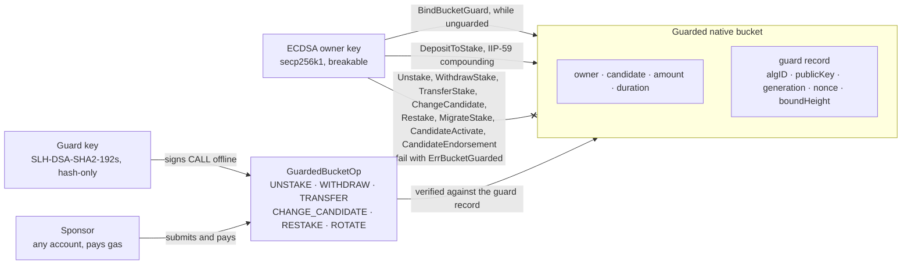
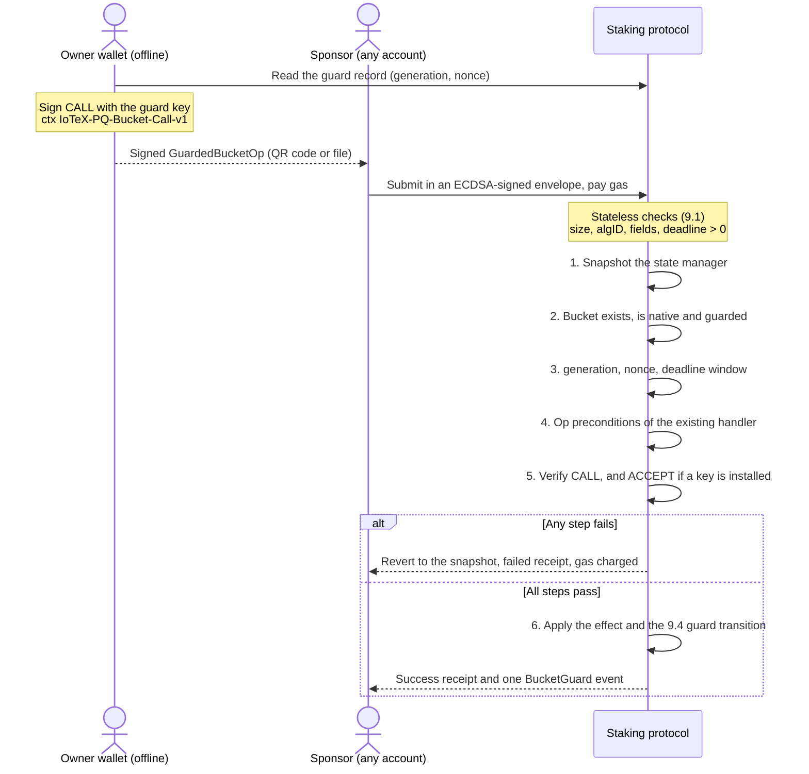
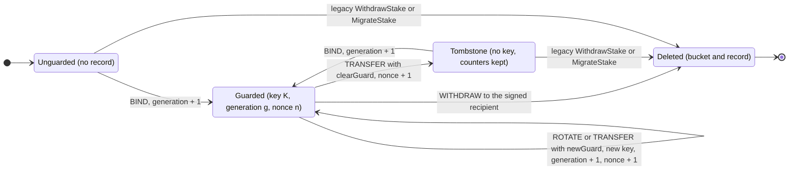

```
IIP: 65
Title: Quantum-Safe Staking Buckets
Author: Raullen Chai (@raullenchai), Chen Chen (@envestcc)
Discussions-to: https://github.com/iotexproject/iips/pull/87
Status: Draft
Type: Standards Track
Category: Core
Created: 2026-10-19
Revised: 2026-10-28 (Draft 2)
Requires: 59, 61, 64
```

## Simple Summary

Give every IOTX holder a post-quantum vault that IoTeX can ship on its own: a
native staking bucket locked with a second, hash-based key (SLH-DSA, NIST
FIPS 205). Once a bucket is locked, nothing that moves, re-owns, unstakes, or
re-votes it is accepted unless that key has signed it. An ECDSA signature alone
is no longer enough. Staked IOTX then stays safe even if secp256k1 is broken,
whether by a quantum computer or by an AI-assisted mathematical result.

## Abstract

This IIP adds an opt-in **bucket guard** to native staking buckets. A guard is an
SLH-DSA-SHA2-192s public key plus replay counters, stored in a new staking-state
namespace. It introduces two new staking actions:

* `BindBucketGuard`, sent by the bucket owner, attaches a guard to a bucket.
* `GuardedBucketOp` performs one of a closed set of bucket operations, authorized
  only by the guard.

On a guarded bucket, the existing ECDSA-authorized bucket actions fail. Any
account may sponsor (submit and pay for) a `GuardedBucketOp`. Hash-based
signatures rely only on the security of the hash function, so a guard is robust
to a break of elliptic-curve or lattice assumptions.

This IIP is a self-contained first deliverable of the IIP-64 migration. It needs
no EVM precompile, no new address format, no emergency mode, no account-level
key change, and no support from exchanges, hardware wallets, or other chains.

### Overview

A guard is an additional lock, not a new owner. The bucket keeps its ECDSA owner,
its votes, and its rewards. What changes is who may move it.



*Figure 1. Once a bucket is guarded, the ECDSA key can only add funds to it.
Every operation that moves, re-owns, unstakes, or re-votes the bucket needs a
signature from the guard key. Anyone can submit that signed operation.*

## Motivation

1. **A vault IoTeX can ship alone.** Post-quantum signatures for ordinary
   accounts (EOAs) depend on decisions that IoTeX does not control: which
   algorithms Ethereum adopts, and whether exchanges, wallets, and hardware
   vendors support them. A transaction format that nobody else signs gives
   users nothing. A staking bucket is different. Every component of a bucket
   guard is a published NIST standard (FIPS 205), signing happens offline in the
   user's wallet, and any account can submit the signed operation. IoTeX can
   therefore offer a safe place for IOTX now, and follow the industry on EOAs
   later.
2. **Time is what makes an opt-in vault work.** A cryptographically relevant
   quantum computer is not believed to be imminent, and Bitcoin and Ethereum
   have not settled their own migrations. That lead time is the opportunity: a
   guard protects only buckets bound before a break, so the vault has to be
   filled ahead of time. A break of a *structured* assumption may also come with
   no hardware warning (IIP-64 §1.5), for example from an AI-assisted classical
   result. Holders are therefore encouraged to bind early.

   ```mermaid
   timeline
       title What a guard protects, before and after an ECDSA break
       section Now
           QSB fork activates : Owners bind guards to their buckets
       section Lead time
           The vault fills : Guarded IOTX keeps staking and earning rewards
       section ECDSA break
           Guarded buckets : Principal and votes stay safe
           Unguarded buckets : An attacker withdraws them or binds its own guard first
       section Post-quantum accounts
           Exit : Holders move funds to post-quantum accounts under IIP-64
   ```

   *Figure 2. The vault only protects what is inside it when the break happens.*

3. **Low-frequency operations can afford conservative cryptography.** Owners
   act on a bucket a few times a year, unlike EOA or contract signatures that a
   DEX user may produce many times a day. Bucket operations can therefore use a
   slow-to-sign, small-signature, hash-only scheme at a high security category.
   The only performance bound that matters on chain is verification, which must
   stay far below the block interval (§8).
4. **Votes are consensus.** Delegates are elected by bucket votes. Someone who
   can forge an owner's ECDSA signature can redirect votes with
   `ChangeCandidate`. Guarding that operation removes a path to capturing
   consensus.
5. **The vault also covers loss of the everyday key.** If an owner loses their
   ECDSA key, the guard alone can withdraw the bucket to a new address or
   transfer it to a new owner, with any account paying the gas.

## Specification

The key words MUST, MUST NOT, SHOULD, and MAY are to be interpreted as in RFC 2119.

### 1. Activation and dependencies

All rules take effect at the height of a future hard fork (`QSBHeight`, set by
governance). Before that height, both new actions are invalid. Activation MUST
NOT precede Zanzibar Gamma, because this IIP relies on the
`RevertStakingStateOnFailedReceipt` behavior (§9).

### 2. Algorithms

Algorithm identifiers are those of the canonical table in IIP-64 §4.1.3, which
is the single registry for post-quantum algorithm identifiers on IoTeX. This IIP
does not allocate identifiers. Identifier values are carried as `uint32` in the
messages and transcripts of this IIP.

The set accepted by this IIP is fixed by consensus and is identical on every
node:

| ID (IIP-64 §4.1.3) | Algorithm | NIST category | Public key | Signature |
|---|---|---|---|---|
| `0x12` | SLH-DSA-SHA2-192s | 3 | 48 bytes | 16,224 bytes |

* Any other algorithm ID MUST be rejected. Accepting another identifier from
  the IIP-64 table requires a future fork and a new parameter version (§8).
* Signatures use the FIPS 205 **external, pure** interface (`slh_sign` /
  `slh_verify`) with the context strings of §7. Pre-hash (HashSLH-DSA) MUST NOT
  be used.
* Implementations MUST select the parameter set from the algorithm ID, never
  from the key or signature bytes.
* Implementations MUST conform to FIPS 205 as published (August 2024), not to
  the SPHINCS+ round-3 submission. In particular, for category 3 the SHA2
  instantiation uses SHA-512 for `H_msg`, `PRF_msg`, `H`, and `T`, and SHA-256
  for `F` and `PRF` (FIPS 205 §11.2.2). Conformance MUST be demonstrated with
  NIST ACVP vectors.

When this IIP activates, the IIP-64 §4.1.3 role column for `0x12` SHOULD list
"bucket guard (this IIP)".

### 3. Scope: which buckets can be guarded

A bucket MAY be guarded only if all of the following hold:

* (a) It is a native bucket (`ContractAddress` is empty). Contract-staking buckets
  are out of scope.
* (b) It is not the self-stake bucket of any candidate.
* (c) It has no endorsement record in any state, including an unendorse-requested
  endorsement.

While a bucket is guarded, the protocol MUST keep (b) and (c) true. A guarded
bucket MUST NOT become a self-stake bucket through `CandidateActivate`, and MUST
NOT receive an endorsement record through `CandidateEndorsement`. Both fail with
`ErrBucketGuarded`. `CandidateRegister` either creates a fresh, initially
unguarded bucket or (zero-stake registration) none, so it is unaffected.

Conditions (b) and (c) are **structural**:

* (b) means no candidate's `SelfStakeBucketIdx` equals the bucket index,
  regardless of unstake or exit status.
* (c) means an endorsement-state `Get` for the bucket returns
  `ErrStateNotExist`.

Implementations MUST NOT substitute `isSelfStakeBucket` or the endorsement
`Status`. Both can report false or none for records that are still referenced or
have expired.

*Rationale:* candidate-level operations (`CandidateActivate`,
`CandidateDeactivate`, `CandidateTransferOwnership`, and the scheduled exit queue
of IIP-61) can change a self-stake bucket's role and vote weight under the
candidate's ECDSA key. They cannot be guarded without migrating candidate keys.
Excluding self-stake and endorsed buckets in v1 keeps every path that changes a
guarded bucket inside §6. Protecting delegate self-stake is left to the
candidate-key migration of IIP-64 §4.7.

### 4. State

A new staking-namespace key prefix `_bucketGuard`, appended to the existing
prefix enumeration (`_const, _bucket, _voterIndex, _candIndex, _endorsement,
_candidateRewardSnapshot, _bucketGuard`), holds the guard records:

```
key   = _bucketGuard || uint64_be(bucketIndex)
value = protobuf BucketGuard
```

```protobuf
message BucketGuard {
  uint32 algID       = 1;  // 0x12
  bytes  publicKey   = 2;  // empty iff cleared
  uint64 generation  = 3;  // incremented on every bind/rotate/transfer-with-new-guard
  uint64 nonce       = 4;  // incremented on every successful GuardedBucketOp
  uint64 boundHeight = 5;  // height of the most recent bind/rotate/transfer-with-new-guard
}
```

* A bucket is **guarded** iff a record exists with a non-empty `publicKey`.
* An absent record is treated as `generation = 0, nonce = 0`.
* `generation` and `nonce` MUST NOT decrease or reset during a bucket's
  lifetime, including across a clear followed by a rebind. Clearing a guard (§6,
  TRANSFER with `clearGuard`) keeps the record as a tombstone: `algID = 0`, an
  empty `publicKey`, `boundHeight = 0`, and both counters retained. A counter
  overflow fails the action with `ErrGuardMismatch`.
* Native bucket indices are never reused, because `totalBucketCount` is
  monotonic. Whenever a native bucket is permanently deleted, by any path
  (guarded WITHDRAW, or a legacy `WithdrawStake` or `MigrateStake` on a bucket
  that was cleared earlier), its guard record, including a tombstone, MUST be
  deleted in the same snapshot. A guard query for a deleted bucket returns
  not-found.
* The record MUST be written through the same state manager and snapshot as the
  bucket, so that revert and historical reads cover it. On the Erigon backend it
  MUST be registered as a storage object.
* The record is canonically encoded (§8 rules). A decoder MUST reject a
  non-canonical stored encoding.

### 5. Action: `BindBucketGuard`

```protobuf
message BindBucketGuard {
  uint64 bucketIndex = 1;
  uint32 algID       = 2;
  bytes  publicKey   = 3;
  bytes  acceptSig   = 4;   // by publicKey over ACCEPT (§7)
}
```

Stateless validation (failure = invalid action): canonical encoding and size
(§8); `algID = 0x12`; `len(publicKey) = 48`; `len(acceptSig) = 16,224`; intrinsic
gas.

Execution (deterministic failures = failed receipt, §9.3):

1. Snapshot the state manager.
2. Load the bucket. It must exist (`ErrInvalidBucketIndex`) and be native
   (`ErrGuardScope`).
3. The caller (outer ECDSA sender) MUST be the owner (`ErrUnauthorizedOperator`).
4. §3 (b) and (c) must hold structurally (`ErrGuardScope`).
5. The guard record must be absent or a tombstone (`ErrGuardScope`).
6. `generation + 1` must not overflow (`ErrGuardMismatch`).
7. Verify `acceptSig` over `ACCEPT(newGeneration = generation+1, resultingOwner =
   owner, deadline = 0)` (`ErrGuardSignature`). This is the proof of possession.
8. Write `{algID, publicKey, generation+1, nonce (unchanged), boundHeight =
   blockHeight}`, emit the bind log, and settle.

Binding is never closed (no cutoff). After an ECDSA compromise, an attacker can
bind an unguarded bucket immediately, even while it is still locked by maturity
or withdraw delays; binding confers no recovery entitlement on the previous ECDSA
controller. **Protection requires binding before compromise.**

### 6. Action: `GuardedBucketOp`

```protobuf
message GuardedBucketOp {
  uint64 bucketIndex = 1;
  uint64 generation  = 2;
  uint64 nonce       = 3;
  uint64 deadline    = 4;   // last valid block height; MUST be > 0 (§9.2)
  uint32 op          = 5;   // tag below
  // op-specific (unused fields MUST be empty/zero):
  bytes  recipient            = 6;   // WITHDRAW: 20-byte address
  bytes  newOwner             = 7;   // TRANSFER: 20-byte address
  string candidateName        = 8;   // CHANGE_CANDIDATE
  bytes  expectedCandidateID  = 9;   // CHANGE_CANDIDATE: 20-byte candidate identifier
  uint32 duration             = 10;  // RESTAKE: days
  bool   autoStake            = 11;  // RESTAKE
  NewGuard newGuard           = 12;  // TRANSFER (or clearGuard), ROTATE
  bool   clearGuard           = 13;  // TRANSFER only
  bytes  sig                  = 14;  // current guard key over CALL (§7)
}
message NewGuard { uint32 algID = 1; bytes publicKey = 2; bytes acceptSig = 3; }
```

| `op` | Name | Effect (reuses existing handler semantics unless noted) |
|---|---|---|
| 1 | UNSTAKE | As `Unstake`, including the auto-stake, maturity, and endorsement preconditions |
| 2 | WITHDRAW | As `WithdrawStake`, but credits `recipient` rather than the caller. Deletes the bucket and the guard |
| 3 | TRANSFER | As `TransferStake` to `newOwner`. Exactly one of `newGuard` / `clearGuard` MUST be set |
| 4 | CHANGE_CANDIDATE | As `ChangeCandidate`. `candidateName` MUST resolve, at execution time, to `expectedCandidateID` |
| 5 | RESTAKE | As `Restake` with `duration` and `autoStake`, including the existing duration validation (duration 0 is accepted, as for `Restake`) |
| 6 | ROTATE | Replace the key with `newGuard`. `generation += 1`. Rotating to the same key is permitted and only advances the counters |

Unknown `op` values MUST be rejected. There is no generic inner-action wrapper.

**Roles.** The outer ECDSA sender is the **sponsor**. It pays gas and advances
its own account nonce, and has no other effect. The guard is the bucket
**authority**. The sponsor may be any account, including the owner. Handlers
MUST receive the guard authorization explicitly, scoped to
`(bucketIndex, generation, op)`. It MUST NOT be implemented as a general flag
that bypasses ownership checks, and every handler MUST act on
`GuardedBucketOp.bucketIndex` only.

**Deadline.** A signed `GuardedBucketOp` is a bearer authorization: anyone who
obtains it can submit it, and it stays valid until its `deadline` height unless
another guarded op advances the nonce first. To bound that exposure, `deadline`
MUST NOT exceed the execution height plus `MAX_DEADLINE_WINDOW` (§8). Wallets
SHOULD use a much shorter window by default (for example, one day).

**Recipient.** `recipient` MUST be a 20-byte account address. The account is
created if absent, and contract addresses are allowed. Withdrawn IOTX leaves the
guard's protection; wallets SHOULD default to a fresh, never-spent address.

**What the guard authorizes.** TRANSFER and WITHDRAW act on the bucket's
execution-time amount, including any deposits and IIP-59 compounding that
arrived after signing.

**Web3 entry.** Both actions MAY also be submitted as Ethereum-format
transactions to the native staking address, one ABI method per action and op.
The ABI form is only an envelope. It MUST decode to the same
`BindBucketGuard` / `GuardedBucketOp` value, and validity, transcripts, and gas
are defined over that decoded value.

### 7. Signed transcripts

Domain separation uses the FIPS 205 context string. Each message type has its
own context, following the IIP-64 naming convention (`IoTeX-PQ-<Purpose>-v1`):

| Message | Signed by | `ctx` (ASCII) |
|---|---|---|
| CALL | current guard key | `IoTeX-PQ-Bucket-Call-v1` (23 bytes) |
| ACCEPT | incoming guard key | `IoTeX-PQ-Bucket-Accept-v1` (25 bytes) |

FIPS 205 prepends `0x00 || uint8(len(ctx)) || ctx` to the signed message, so the
contexts are length-delimited and no context can be a prefix of another. The
transcripts below carry no further domain tag. Any change to a transcript layout
MUST change the `-vN` suffix of its context.

All integers are big-endian with the stated widths. `chainID` is the native
chain ID `protocol.MustGetBlockchainCtx(ctx).ChainID` (uint32: mainnet 1,
testnet 2), **not** the EVM network ID (4689 / 4690). Booleans are a single
byte, `0x00` or `0x01`. Addresses are their 20 raw bytes. `bytes(x)` is
`uint32_be(len(x)) || x`. Messages are signed directly with pure SLH-DSA, with
no intermediate digest.

```
CALL   = uint32 chainID || uint64 bucketIndex || owner(20)
       || uint64 generation || uint64 nonce || uint64 deadline || uint32 op
       || bytes(recipient) || bytes(newOwner)
       || bytes(candidateName) || bytes(expectedCandidateID)
       || uint32 duration || uint8 autoStake
       || uint8 hasNewGuard || [uint32 algID || bytes(publicKey)]   // if hasNewGuard
       || uint8 clearGuard

ACCEPT = uint32 chainID || uint64 bucketIndex
       || uint64 newGeneration || resultingOwner(20)
       || uint32 algID || bytes(publicKey) || uint64 deadline
```

* CALL is signed by the current guard key. `owner` is the bucket owner at
  execution time.
* ACCEPT is signed by the incoming key:
  * BIND: `newGeneration = generation+1`, `resultingOwner = owner`, `deadline = 0`.
  * ROTATE: `newGeneration = generation+1`, `resultingOwner = owner`, and the
    `deadline` of the CALL.
  * TRANSFER with `newGuard`: `newGeneration = generation+1`,
    `resultingOwner = newOwner`, and the `deadline` of the CALL.
* A guarded operation that installs a new key therefore carries two signatures.
* ACCEPT is the incoming key's acceptance of the resulting binding: bucket, next
  generation, resulting owner, key, and deadline. It is **not** approval of one
  particular CALL. The operation itself is authorized only by the current guard's
  CALL signature, and that signature commits to the incoming key.

What each bound field rules out (non-normative):

| Field | Prevents |
|---|---|
| context (`-Call-` / `-Accept-`) | Using a CALL signature as an ACCEPT, or either as a signature from another IIP-64 domain |
| `chainID` | Replay between mainnet, testnet, and other IoTeX chains |
| `bucketIndex` | Replay on another bucket guarded by the same key |
| `owner` / `resultingOwner` | Execution after the owner changed in a way the signer did not approve |
| `generation` | Replay after a rotation, a transfer with a new guard, or a clear and rebind |
| `nonce` | Replay of an executed op under the same key |
| `deadline` | Execution of a stale op; bounded by `MAX_DEADLINE_WINDOW` |
| `op` and op fields | Using an authorization for one operation as another |
| `expectedCandidateID` | A candidate name that was re-registered by someone else after signing |
| `algID`, `publicKey` of `newGuard` | Swapping the incoming key after the current guard signed |

### 8. Parameters, encoding, size, and gas

Consensus parameters are grouped into a versioned set. This IIP defines
`ParamsV1`. A change to any value (gas recalibration, a new algorithm, a size
limit) is a new version activated at a new fork, so that historical blocks
always replay under the parameters they were produced with.

| Parameter | `ParamsV1` value | Notes |
|---|---|---|
| Accepted algorithms | `{0x12}` | §2 |
| `MAX_BIND_SIZE` | 17,000 bytes | `BindBucketGuard` |
| `MAX_OP_SIZE` | 17,000 bytes | `GuardedBucketOp` without `newGuard` |
| `MAX_OP_NEWGUARD_SIZE` | 34,000 bytes | `GuardedBucketOp` with `newGuard` |
| `G_BASE` | 10,000 | |
| `G_BYTE` | 100 per byte | Equal to the existing staking payload price |
| `G_VERIFY` | 30,000 per verification | Pending linux/amd64 calibration |
| `MAX_DEADLINE_WINDOW` | 120,960 blocks | About 7 days at 5-second blocks |

* **Canonical encoding (consensus object).** Validity and pricing are defined
  over the **decoded** `BindBucketGuard` / `GuardedBucketOp` value, not over
  received bytes (decoders upstream of staking, such as API, gossip, and block
  deserialization, see only decoded messages). `size` is the length of the
  canonical encoding `C(m)` of the decoded message `m`, where `C` is defined
  recursively: fields emitted in ascending field-number order; each present
  field emitted exactly once; scalar and `bytes`/`string` fields with the proto3
  default value omitted; varints in minimal (shortest) form; length prefixes
  minimal; a nested message (`newGuard`) emitted iff set, as `C(newGuard)`; no
  unknown fields. Implementations MUST compute `size` with an encoder conforming
  to this definition (not by measuring received bytes). Ingress nodes SHOULD
  additionally reject non-canonical wire encodings, but this is relay policy, not
  consensus.
* **Limits** are checked in stateless validation.
* **Intrinsic gas:** `G_BASE + G_BYTE·size + k·G_VERIFY`, where `k` is the number
  of SLH-DSA verifications the action requires (1, or 2 with `newGuard`). A bind
  or a single-key op of about 16.3 KB costs about 1.67 M gas; an op with
  `newGuard` of about 32.5 KB costs about 3.32 M gas. Exact vectors are given in
  §Test Cases. The usual envelope rules (gas price, limit) apply unchanged.
* **Why `G_BYTE` equals the staking payload price.** A `GuardedBucketOp` whose
  signature fails is still includable and charged (§9.3), so its bytes are paid
  data on chain. Pricing them below other payloads would make this action the
  cheapest way to store arbitrary data. Bucket operations are rare, so the cost
  to honest users is small.
* **`G_VERIFY = 30,000`.** SLH-DSA-SHA2-192s verification measured 0.233 ms
  (CIRCL v1.6.5, Go 1.26.5, Apple M3 Pro, darwin/arm64). At the ~60 Mgas/s
  execution budget assumed by current Ethereum repricing work (≈16.7 ns/gas)
  this is ≈14,000 gas; `G_VERIFY` adds a 2× margin. The benchmark source,
  dependency versions, and raw results are in `assets/iip-qsb/bench/`.
  linux/amd64 measurements of the full action, not just the primitive, MUST be
  added before this IIP leaves Draft. Any change MUST be made by amending this
  IIP and its vectors. Validators MUST run native binaries; an emulated build
  (for example, Rosetta 2) measured about 8× slower.
* **Block-level bound.** At a 25 M block gas limit, a block can hold at most
  about 15 guarded actions of 16 KB, which is about 3.5 ms of verification and
  under 0.5 MB of action data. Both are far below the block interval and the
  default p2p `MaxMessageSize` (12 MB).

### 9. `GuardedBucketOp` validation, execution, and failure semantics

#### 9.1 Stateless validation (failure = invalid action, not includable)

Canonical encoding and size (§8); known `op`; per-op field rules (required
fields present, all others at default); fixed lengths (20-byte addresses,
48-byte keys, 16,224-byte signatures, `newGuard.algID = 0x12`); `deadline > 0`;
existing staking sanity checks for the op (e.g. restake duration bound,
candidate-name format); intrinsic gas.

#### 9.2 Execution

1. Snapshot the state manager before any guard or staking write.
2. Load the bucket (`ErrInvalidBucketIndex` if absent) and require it native and
   guarded (`ErrBucketNotGuarded`).
3. Require `generation`, `nonce` equal to stored; `blockHeight ≤ deadline ≤
   blockHeight + MAX_DEADLINE_WINDOW`; no counter overflow
   (`ErrGuardMismatch`).
4. Op-specific state preconditions, with the existing handlers' receipt statuses
   (maturity, auto-stake, unstaked, etc.); for CHANGE_CANDIDATE the resolved
   candidate's identifier MUST equal `expectedCandidateID`
   (`ErrCandidateMismatch`).
5. Verify CALL, then ACCEPT if present (`ErrGuardSignature`).
6. Apply the transition (§9.4) through the existing staking state-manager helpers
   (bucket, owner/candidate indexes, bucket pool, IIP-59 copy-on-write hooks).
7. Emit success logs; settle.



*Figure 3. Signing and submission are separate. The node evaluates the steps
in this order, and the order decides the receipt status.*

The step order fixes which receipt status is reported when several checks fail.
An implementation MAY evaluate step 4 and apply step 6 before step 5, provided
that a failure at step 5 restores the state manager and every protocol view to
the step-1 snapshot (see §Test Cases for the required invariant test).

#### 9.3 Failure classification

* **Deterministic protocol failures**, meaning every condition named with a
  receipt status above or in the existing handlers, revert to the snapshot (no
  guard or staking change persists, **no success logs are emitted**), then
  produce a failed receipt that charges the sponsor's gas and advances the
  sponsor's account nonce exactly once. The guard nonce does not advance.
* **Non-deterministic or fatal errors**, such as storage backend errors,
  corruption, or a failed snapshot revert or settlement, MUST propagate as fatal
  block-processing errors exactly as non-`ReceiptError` errors do today; they
  never yield an includable failed receipt.
* **Classification precedence.** Backend/corruption classification takes
  precedence over legacy receipt wrappers: existing helpers that wrap any read or
  write error as a `ReceiptError` (e.g. `fetchBucket`, `fetchCaller`, the
  bucket-pool credit in withdraw) MUST, when called on behalf of these actions,
  distinguish `ErrStateNotExist`-type deterministic outcomes (which keep their
  statuses) from all other storage errors (which are fatal). Any change to legacy
  actions' classification is out of scope and MUST remain fork-gated if made.

#### 9.4 Guard state transitions (on success)



*Figure 4. Counters never decrease while the bucket exists, so a signature
from an earlier key or an earlier binding can never execute again. Only a
guard signature leads out of the Guarded state.*

| op | Bucket effect | Guard record after |
|---|---|---|
| UNSTAKE / CHANGE_CANDIDATE / RESTAKE | existing handler effect | `nonce+1`; other fields unchanged |
| WITHDRAW | bucket deleted, amount credited to `recipient` | **deleted** (log reports consumed `nonce` and resulting `nonce+1`) |
| TRANSFER + `newGuard` | owner := `newOwner` | key := new; `generation+1`; `nonce+1`; `boundHeight` := height |
| TRANSFER + `clearGuard` | owner := `newOwner` | tombstone (`algID 0`, empty key, `boundHeight 0`); `generation`, `nonce+1` retained |
| ROTATE | none | key := new; `generation+1`; `nonce+1`; `boundHeight` := height |

#### 9.5 Receipt statuses

New `ReceiptStatus` values (proposed numbers, final assignment in `iotex-proto`):
`ErrBucketGuarded = 216`, `ErrBucketNotGuarded = 217`, `ErrGuardMismatch = 218`,
`ErrGuardSignature = 219`, `ErrGuardScope = 220`, `ErrCandidateMismatch = 221`.
Existing `ErrInvalidBucketIndex (202)` and `ErrUnauthorizedOperator (203)` are
reused as stated. Proposed `ActionCore` oneof fields: `bindBucketGuard = 59`,
`guardedBucketOp = 60`.

#### 9.6 Mempool policy (non-consensus)

Nodes SHOULD run §9.2 steps 2–5 against their current state when admitting a
`GuardedBucketOp` or `BindBucketGuard`, and SHOULD neither keep nor relay one
that fails. This keeps invalid-signature actions, which are 16–34 KB each, out
of gossip and out of honest proposers' blocks. It is relay policy only: every
step is re-evaluated against execution-time state, and a block containing a
failing action remains valid.

### 10. Effects on existing actions

On a guarded bucket:

| Existing action | Result |
|---|---|
| `Unstake`, `WithdrawStake`, `TransferStake` (including consignment), `ChangeCandidate`, `Restake` | Failed receipt `ErrBucketGuarded` |
| `MigrateStake` | Failed receipt `ErrBucketGuarded` (leaving to ERC-721 control is not permitted) |
| `CandidateActivate` targeting it / `CandidateEndorsement` on it | Failed receipt `ErrBucketGuarded` |
| `DepositToStake` | Unchanged (permitted to anyone under the existing conditions; guard state untouched) |
| IIP-59 `AddDepositForCompound` | Unchanged (permitted; guard state untouched) |

**Voter rewards are account-level and unchanged.** Under IIP-59, a voter's
reward routing is set per account, not per bucket: the voter chooses a
compounding bucket in the AutoDeposit contract and may set a reward destination
with `SetVoterRewardDestination`. Both remain ECDSA-controlled under this IIP.
A guarded bucket with `autoStake` enabled is an eligible compounding target, and
rewards compounded into it become part of the guarded principal. See Security
Considerations for the residual exposure.

Receipt status numbers are listed in §9.5.

### 11. Events and API

Each successful `BindBucketGuard` or `GuardedBucketOp` emits **exactly one**
event log. The emitter is the staking protocol address, and the log is produced
by a single `AddEvent(topics, data)` call.

* `topic[0]` =
  `0x73a1cc2c5c34de8d095f5003eb096fa77f44357dd83dcea0225ca286942426ec`, which is
  Keccak-256 of the ASCII string
  `BucketGuard(uint64,uint64,uint64,uint64,address,address)`. The string serves
  only to derive the constant; the data below is not ABI-encoded.
* `topic[1]` = `bucketIndex`, and `topic[2]` = `op`. Each is a big-endian
  integer left-padded with zeros to 32 bytes. `op = 0` denotes BIND, and 1–6 the
  ops in §6.
* `data` = `uint64_be(generation) || uint64_be(nonce) || sponsor(20) ||
  counterparty(20)`, which is 56 bytes:
  * The counters are the resulting values. For WITHDRAW the record is deleted and
    `nonce` is the consumed value plus 1.
  * `counterparty` is `newOwner` for TRANSFER, `recipient` for WITHDRAW, and 20
    zero bytes otherwise.

The legacy per-handler logs (`unstake`, `withdrawStake`, …) are **not** emitted
for guarded ops. Transaction logs are emitted as today: gas-fee logs always
(including on failure), and for WITHDRAW one `WITHDRAW_BUCKET` transaction log
from the bucket pool to `recipient`. On failure, only the gas-settlement
transaction logs and the failed status appear.

The guard of a bucket is queryable at any height through
`ReadStakingData` (method `BUCKET_GUARD`) and through `eth_call` of
`bucketGuard(uint64)` on the native staking address. Both return `algID`,
`publicKey`, `generation`, `nonce`, and `boundHeight`; an empty `publicKey`
means unguarded.

### 12. Wallet profile `QSB-KDF-v1`

This section is a **wallet interoperability requirement**, not a consensus rule:
consensus verifies possession (ACCEPT), and cannot verify derivation.

#### 12.1 Derivation

```
prk = HKDF-Extract(salt = "IoTeX-PQ-Bucket-KDF-v1", IKM = bip39_seed)     // HMAC-SHA-512
okm = HKDF-Expand(prk, info = "slh-dsa-sha2-192s" || uint32_be(account)
                             || uint32_be(keyIndex), L = 72)
(SK.seed, SK.prf, PK.seed) = okm[0:24], okm[24:48], okm[48:72]
(sk, pk) = slh_keygen_internal(SK.seed, SK.prf, PK.seed)                  // FIPS 205 Alg. 18
```

* `bip39_seed` is the 64-byte BIP-39 seed (PBKDF2 output), not any BIP-32 node.
* `account` is the BIP-44 account index of the address that will own the bucket
  after the key is installed (the binder for BIND/ROTATE; the **new owner** for
  TRANSFER with `newGuard`, whose wallet produces `newGuard` and its ACCEPT).
  With a dedicated vault mnemonic (§12.2), `account` is 0.
* `keyIndex` is allocated per `(seed, account)`, starting at 0, and incremented
  each time a new guard key is derived for that account (bind, rotate, or
  receiving a transfer). A wallet MAY reuse one key across several buckets, as
  transcripts are bucket-scoped. `keyIndex` ranges over `0 … 1023`.
* Because SLH-DSA is stateless, reusing a key index (across buckets or after a
  lost high-water mark) is **safe**; index allocation is a convenience, not a
  security requirement.

#### 12.2 Key-material requirements

* The input key material MUST NOT be a secp256k1 private key, a BIP-32 extended
  key, or any value computable from them. A party that recovers the owner's
  ECDSA key after a break must learn nothing about the guard key. A seedless
  account (imported private key, keystore) MUST NOT derive a guard key from its
  private key; it MUST use a dedicated vault mnemonic or a randomly generated
  guard key with an explicit backup.
* The mnemonic SHOULD have 24 words (256 bits of entropy). The guard key is no
  stronger than its seed, and a 12-word mnemonic (128 bits) caps it below the
  category-3 target of §2.
* Wallets SHOULD offer a **dedicated vault mnemonic**, separate from the
  mnemonic of everyday accounts. This keeps the guard a true second factor
  against malware and phishing that steal an everyday seed, and lets
  hardware-wallet users keep their device seed off general-purpose computers.

#### 12.3 Signing

* Wallets SHOULD sign with the FIPS 205 **hedged** variant (fresh randomness),
  not the deterministic variant. Deterministic signing is used only to produce
  test vectors.
* Wallets MUST verify every signature they produce before releasing it. This
  defends against fault attacks on hash-based signatures, in which one faulty
  signature can leak material that enables forgery.
* Signing and submission are separate. Wallets SHOULD support signing on an
  offline device and transferring the signed operation (for example by QR code
  or file) to any online account for submission.

#### 12.4 Recovery

Recovery requires no extra backup, because guard public keys are on chain. A
restoring wallet derives `pk` for **every** `keyIndex` in `0 … 1023` for each of
its accounts (exhaustive, no gap limit; ≈ 26 s per account on an Apple M3 Pro,
≈ 30 s on an Apple M2 Pro, several minutes on emulated or slow devices;
resumable) and matches against the on-chain `publicKey` of each guarded bucket it
owns. It then continues allocating from the highest matched index + 1 (or any
index; reuse is safe).

## Rationale

### Why buckets first

* **Ecosystem independence.** An EOA migration needs a signature format that
  exchanges, wallets, hardware vendors, and the EVM tooling accept, and that
  decision is being made elsewhere. A bucket guard needs only an IoTeX wallet to
  sign and any account to submit. It is the part of IIP-64 that IoTeX can
  deliver without waiting for others.
* **A vault does not need an exit.** Guarded IOTX keeps earning staking rewards
  while it waits. Holders can leave the vault once post-quantum accounts exist.
  Until then, the guard protects principal and votes, which is the asset worth
  protecting.

### Why hash-based: a hedge against quantum computers and AI-accelerated mathematics

A vault should rest on the assumption that is least likely to fail. There are
two separate ways a signature scheme can fail, and they point to the same
choice.

1. **Quantum computers.** Shor's algorithm breaks elliptic-curve signatures,
   including the ECDSA keys that control buckets today. ML-DSA (lattice-based,
   FIPS 204) and SLH-DSA (hash-based, FIPS 205) both resist every known quantum
   algorithm. On this threat alone, either would do.
2. **Mathematics, now accelerated by AI.** ECDSA, ML-DSA, and FN-DSA (Falcon)
   are secure because a specific *algebraic* problem is believed to be hard:
   discrete logarithms on an elliptic curve, or short vectors in a structured
   lattice (Module-LWE/SIS, NTRU). Algebraic structure is exactly what
   cryptanalysis exploits, and a better algorithm needs no new hardware. This has
   happened to schemes deep in the NIST process itself: in 2022 the
   isogeny-based SIKE (a round-4 candidate) was broken by a classical attack that recovers a key in
   about an hour on a single core ([Castryck–Decru, ePrint
   2022/975](https://eprint.iacr.org/2022/975)), and the multivariate Rainbow
   signature (a round-3 finalist) fell to a key-recovery attack that takes about a weekend on a
   laptop ([Beullens, ePrint 2022/214](https://eprint.iacr.org/2022/214)).
   Older precedents include the number field sieve, which forced RSA keys to
   grow several-fold. AI-assisted mathematical research raises the rate at which
   such results can appear. Vitalik Buterin made this argument for Ethereum in
   October 2026, writing that "there is a good chance that the concrete security
   of lattices will take serious hits" and concluding "hash-based >
   lattice-based, in those situations where hash-based is possible at all"
   ([post, 2026-10-07](https://x.com/VitalikButerin/status/2107976296320106851)).
   Ethereum's own post-quantum roadmap has moved toward hash-based signatures
   for the same reason.

SLH-DSA is the scheme that hedges both threats. Its security reduces only to
standard properties of the hash function (preimage and second-preimage
resistance, and pseudorandomness), and it has no algebraic structure to attack.
The best known attacks are generic: Grover's algorithm gives at most a quadratic
speedup, which the NIST security categories already account for. A practical
break of SHA-2 at this level would also break most of the internet's existing
security infrastructure, so it is the most conservative assumption available.

| Scheme | Security rests on | Shor (quantum) | Algebraic or AI-assisted breakthrough | Signature |
|---|---|---|---|---|
| ECDSA secp256k1 (today) | Elliptic-curve discrete log | **Broken** | Exposed | 64–65 B |
| ML-DSA-65 (FIPS 204), cat. 3 | Module-LWE / SIS lattices | Resists | Exposed | 3,309 B |
| FN-DSA / Falcon (FIPS 206) | NTRU lattices | Resists | Exposed | 666 B (cat. 1), 1,280 B (cat. 5) |
| **SLH-DSA-SHA2-192s (FIPS 205), cat. 3** | **Hash function only** | **Resists** | **No structure to attack** | **16,224 B** |

The price is size: an SLH-DSA-192s signature is about five times an ML-DSA-65
signature. Bucket operations happen a few times a year, so this IIP pays that
cost to get the narrowest assumption (Motivation 3). This is a hedge, not a
claim that lattices will fall. Lattice schemes remain the practical choice for
high-frequency signing, and IIP-64 keeps identifiers for them for EOAs and
other uses. The same argument also applies to ECDSA: a classical break may
arrive with no quantum hardware warning, which is why holders should bind early
(Motivation 2).

### Why these parameters

The guiding rule is the one in Motivation (3): bucket operations are rare, so
the design takes the most conservative option whose on-chain cost stays
reasonable. Signing speed is not a constraint at all, because signing happens
offline. Verification speed is a constraint only relative to the block interval,
and every candidate below is four orders of magnitude under it. What decides the
choice is the security category and the on-chain size.

| Parameter set (SHA2) | NIST cat. | Signature | Sign (M3 Pro) | Verify (M3 Pro) | Assessment |
|---|---|---|---|---|---|
| SLH-DSA-128s | 1 | 7,856 B | 0.14 s | 0.13 ms | Smaller, but less margin than a long-term vault calls for |
| **SLH-DSA-192s** | **3** | **16,224 B** | **0.36 s** | **0.23 ms** | **Chosen** |
| SLH-DSA-256s | 5 | 29,792 B | 0.26 s | 0.34 ms | 1.84× the size for little practical gain |
| SLH-DSA-192f | 3 | 35,664 B | 0.01 s | 0.63 ms | Designed for frequent signing; larger and slower to verify |
| SLH-DSA-SHAKE-192s | 3 | 16,224 B | 1.14 s | 1.01 ms | Same security, 4× slower verification |

* **Hash-based only.** v1 admits no lattice or other structured scheme, for the
  reasons in the previous subsection.
* **Stateless SLH-DSA, not WOTS/XMSS.** Stateful keys fail when users sign from
  several devices or restore from a seed.
* **SHA2 over SHAKE.** 4–5× faster verification. The SPHINCS+ round-3 weakness
  of the SHA2 variants at categories 3 and 5 (Perlner, Kelsey, and Cooper, 2022)
  is fixed in FIPS 205 by the SHA-512 instantiation required in §2.
* **Pure interface, no pre-hash.** Signing the full transcript avoids a 256-bit
  intermediate digest, which would cap collision resistance below the category-3
  target.
* **Limited-signature parameter sets.** NIST SP 800-230 defines SLH-DSA sets
  with smaller signatures and a hard cap of 2^24 signatures per key; IIP-64
  reserves `0x16`–`0x1B` for them. A guard key signs a few times a year, so
  these sets fit the use case, and a future parameter version MAY admit one
  after SP 800-230 is final. v1 does not.

### Other design choices

* **Guard record, not a new owner.** The owner, bucket index, voting, and rewards
  keep working unchanged. The guard is an additional lock.
* **No ECDSA escape hatch, and no emergency mode.** Any ECDSA path to remove a
  guard is a path an attacker could use. `clearGuard` is guard-authorized, not
  an ECDSA path; it deliberately returns the bucket to ECDSA control and is
  covered in Security Considerations. Losing the guard key is mitigated by
  deriving it from a seed (§12).
* **Explicit operations instead of wrapping existing actions.** Wrapping the
  existing actions would require signing over a byte encoding that does not
  uniquely identify the operation (`Unstake` and `WithdrawStake` share one
  payload encoding). A closed op set with a byte-exact transcript avoids this.
* **Per-message contexts instead of in-transcript domain tags.** The FIPS 205
  context is length-delimited, so it separates CALL from ACCEPT, and both from
  every IIP-64 domain, without a hand-rolled tag format.

## Backward Compatibility

The guard is opt-in. Unguarded buckets and every existing action on them behave
exactly as before. Indexers see two new action types, new receipt statuses, and
one new event.

## Test Cases

The following must be covered before activation:

* Behavior at the fork boundary (`QSBHeight − 1` vs `QSBHeight`).
* Each op's success and precondition failures.
* Every rejected path in §10, including consignment and migration.
* Wrong bucket, operation, chain, owner, or candidate ID.
* Expired deadline, and a deadline beyond `MAX_DEADLINE_WINDOW`.
* A signature made with the wrong context (CALL signed under the ACCEPT context
  and vice versa).
* Malformed or invalid ACCEPT.
* Replay after rotation, and after clear and rebind.
* Competing sponsors for the same signed op.
* Failed execution: snapshot rollback of the guard, bucket, indexes, and pool,
  with the sponsor still charged.
* **Rollback invariant:** for every op, a CALL or ACCEPT signature failure leaves
  the state root and every protocol view byte-identical to their state before
  the action, apart from the sponsor's gas and nonce.
* **Scope invariant:** no sequence of actions makes a guarded bucket a self-stake
  bucket or gives it an endorsement record (every writer of
  `SelfStakeBucketIdx` and of endorsement records is exercised).
* Withdraw deleting the guard.
* Both storage backends, including historical guard reads.
* FIPS 205 ACVP vectors for the primitive, plus protocol transcript vectors and
  KDF vectors.
* Exact `size` and intrinsic gas vectors for bind and every op variant.
* Exact receipt and log vectors (success and failure).
* A recovery vector for one bucket rotated 64 times (the active key at
  `keyIndex = 64`).
* Bind/activate and bind/endorse in both orders within one block; pending exits;
  expired endorsement records; transfers to and from candidate owners.
* A clear followed by a legacy withdraw, and a clear followed by migration, each
  deleting the tombstone.
* A bind by a compromised ECDSA owner before any guard exists, installing an
  attacker-chosen guard key (the pre-bind compromise case).
* Injected storage failures on bucket reads, account reads, and pool writes. Each
  must abort block processing rather than produce a receipt.
* Fuzzing of action decoding, of the guard record decoder, and of the ABI
  envelope.
* Vectors MUST be published with the reference implementation, before this IIP
  leaves Draft.

## Implementation

A reference implementation is in progress in `iotex-core` (PR #5059, built on
the `qsb-draft/quantum-safe-staking-buckets` branch):

* `pkg/pqcrypto`: domain-neutral verification, the algorithm registry, and a
  transcript builder; `pkg/pqcrypto/signer` holds the wallet-side derivation and
  signing, and is not imported by consensus code.
* `action/protocol/staking/bucketguard`: the rules of this IIP as pure functions
  (`AuthorizeBind`, `CheckOp`, `CheckCandidate`, `VerifyOp`, `Next`,
  `RejectIfGuarded`) with versioned `Params`.
* `action/`: the new action types and the web3 envelope, plus the protobuf
  messages in `iotex-proto`.
* `action/protocol/staking`: guard state, the two handlers, the guard checks in
  the existing handlers, and the query API.
* Feature-context gating; `tools/qsbctl` for testing on a local network.

The reference implementation predates Draft 2 and must be updated for the
changes listed under Revision History.

## Security Considerations

* **Bind before compromise.** Only buckets bound before a break are protected.
  Binding is authorized by the current ECDSA owner, so an attacker who
  compromises that key first can bind the bucket to an attacker-chosen guard
  key. There is no protocol-level way to distinguish this from the owner's bind.
  The adoption rate is therefore the main security metric of this IIP, and
  wallets and the community SHOULD encourage early binding. A later IIP MAY
  define an emergency response for buckets still unbound at a break (for
  example, freezing legacy bucket actions and recovering by a hash-based proof
  of seed knowledge); this IIP does not.
* **Exits land in ECDSA accounts.** WITHDRAW credits, and TRANSFER assigns to, a
  20-byte ECDSA address. After a break, funds taken out of the vault are exposed
  again. Holders SHOULD keep IOTX in the vault until post-quantum accounts
  exist, and wallets SHOULD withdraw to a fresh address whose public key has
  never been revealed.
* **Voter rewards.** IIP-59 reward routing is account-level and stays
  ECDSA-controlled (§10). Rewards already compounded into a guarded bucket are
  protected principal. After a break, an attacker holding the owner's ECDSA key
  can redirect *future* rewards by changing the AutoDeposit target or the reward
  destination, but cannot touch principal or votes. Owners SHOULD enable
  `autoStake` on a guarded bucket and set it as their AutoDeposit target before
  a break. Pinning reward routing to a guard is left to a future IIP.
* **Guard key compromise.** The guard protects against a break of ECDSA, not
  against theft of the guard key itself. A dedicated vault mnemonic (§12.2)
  separates the two keys. A stolen guard key allows an immediate TRANSFER; a
  cooling period with a backup-key veto is a candidate for a future version.
* **Seed strength.** The guard key is no stronger than its seed (§12.2).
* **Fault attacks on signing.** Hash-based signatures are vulnerable to fault
  injection during signing. Hedged signing and verify-before-release (§12.3)
  are the mitigations.
* **ClearGuard is an opt-out.** A guard-signed TRANSFER with `clearGuard`
  returns the bucket to ECDSA control. A later legacy withdraw or migration
  deletes the tombstone. This is intentional and requires the guard key; it is
  not a recovery path for a lost guard key.
* **Lost guard key.** The bucket is permanently locked. This is mitigated by the
  seed-derived key (§12).
* **Bearer authorizations.** A signed op can be submitted by anyone until its
  deadline; `MAX_DEADLINE_WINDOW` bounds the exposure (§6). A copied op executes
  the identical signed effect; a competing sponsor can only pay for it.
* **Paid data.** Invalid-signature actions are includable. `G_BYTE` (§8) and the
  mempool policy (§9.6) keep them from becoming a cheap data channel.
* **Hardware wallets.** Current hardware wallets cannot produce SLH-DSA
  signatures. The offline-signing workflow of §12.3 is the interim answer.
* **Residual exposure.** Delegate operator and reward keys, delegate self-stake
  buckets, contract-staking buckets, liquid balances, and IIP-59 reward routing
  all remain ECDSA-controlled until later IIPs. An elected candidate's operator
  identity remains ECDSA-controlled even when the votes for it are guarded.
* **Implementation risk.** This IIP adds consensus-critical SLH-DSA verification.
  The library version MUST be pinned, the implementation MUST be tested against
  ACVP vectors, decoding MUST be fuzzed, and the implementation SHOULD receive an
  external audit before activation.

## Revision History

**Draft 2 (2026-10-28)** changes Draft 1 as follows:

* Motivation and Rationale: the vault framing; why buckets come before EOAs; the
  low-frequency principle and the parameter comparison; why hash-based
  (a hedge against both quantum computers and AI-accelerated cryptanalysis of
  structured assumptions).
* §2: identifiers come from IIP-64 §4.1.3; FIPS 205 final conformance (SHA-512
  instantiation at category 3) is required.
* §6: `MAX_DEADLINE_WINDOW` bounds signed-op lifetime; RESTAKE duration 0 and
  same-key ROTATE are stated explicitly; the web3 entry is specified.
* §7: domain separation moves into per-message FIPS 205 contexts
  (`IoTeX-PQ-Bucket-Call-v1`, `IoTeX-PQ-Bucket-Accept-v1`), replacing
  `ctx = "IOTEX-PQ-BUCKET-v1"` and the in-transcript tags `IOTX-QSB-CALL` /
  `IOTX-QSB-ACCEPT`. **All transcript vectors change.**
* §8: parameters are grouped as `ParamsV1`; `G_BYTE` rises from 16 to 100 per
  byte, equal to the staking payload price. **All gas vectors change.**
* §9.6: mempool pre-verification policy.
* §10: IIP-59 reward routing is documented as account-level and unchanged.
* §11: query API names.
* §12: the KDF salt becomes `IoTeX-PQ-Bucket-KDF-v1` (**all KDF vectors
  change**); new requirements on key material (no derivation from ECDSA keys,
  24-word mnemonic, dedicated vault mnemonic) and on signing (hedged, verify
  before release, offline signing).
* Test Cases: rollback and scope invariants, context-confusion, deadline window,
  fuzzing of the envelope and record decoder.

## Copyright

Copyright and related rights waived via
[CC0](https://creativecommons.org/publicdomain/zero/1.0/).
